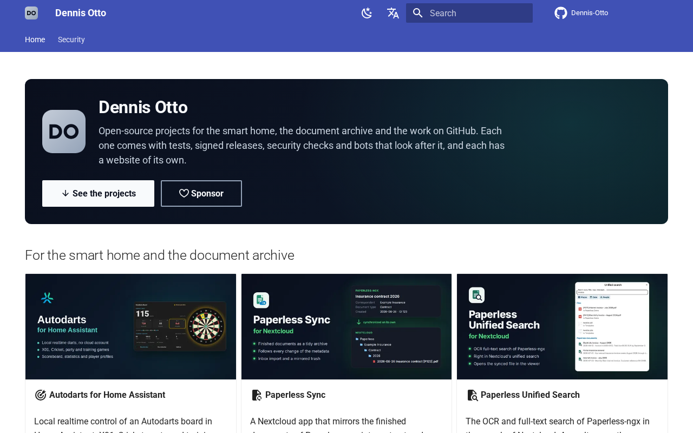
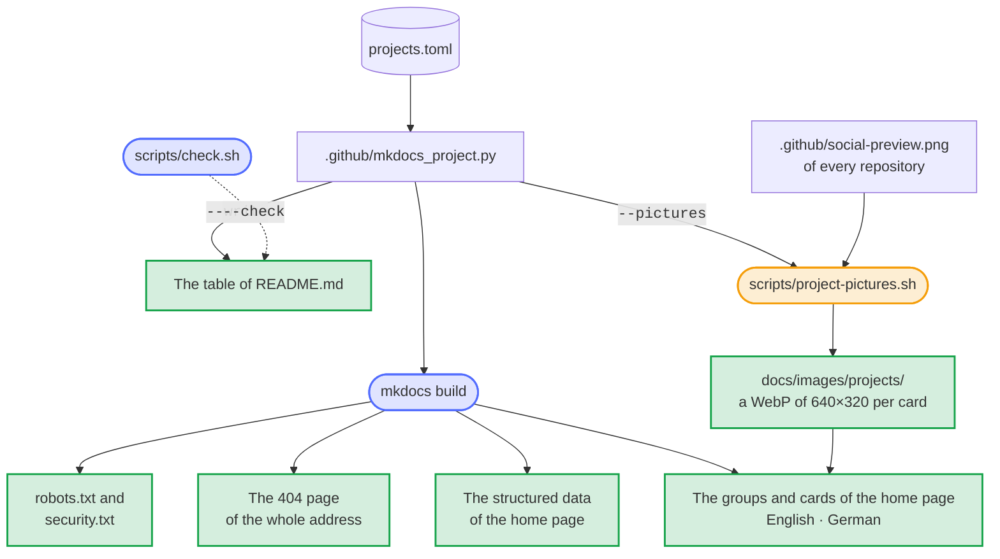
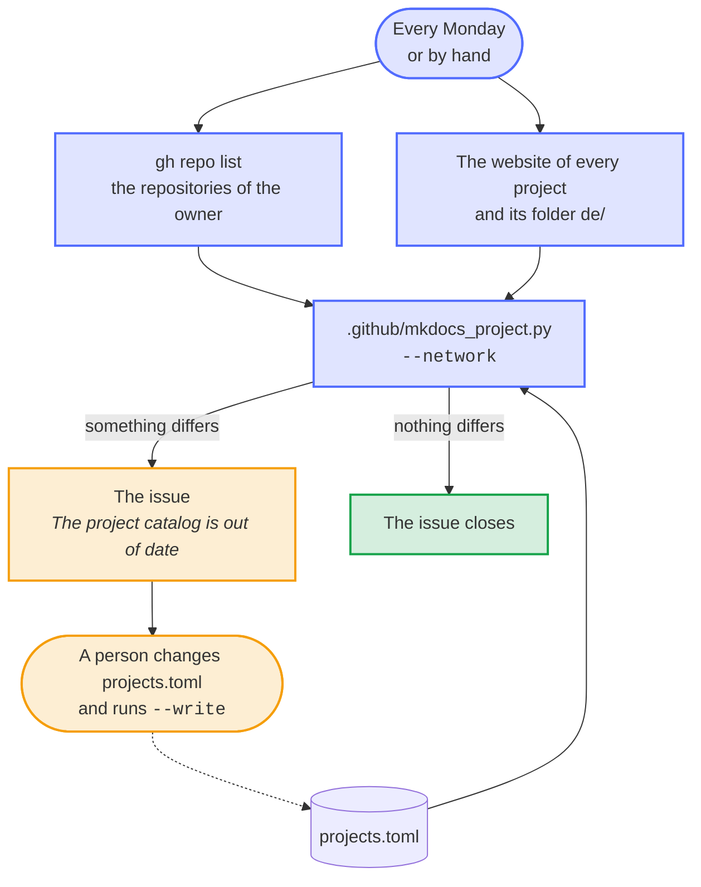
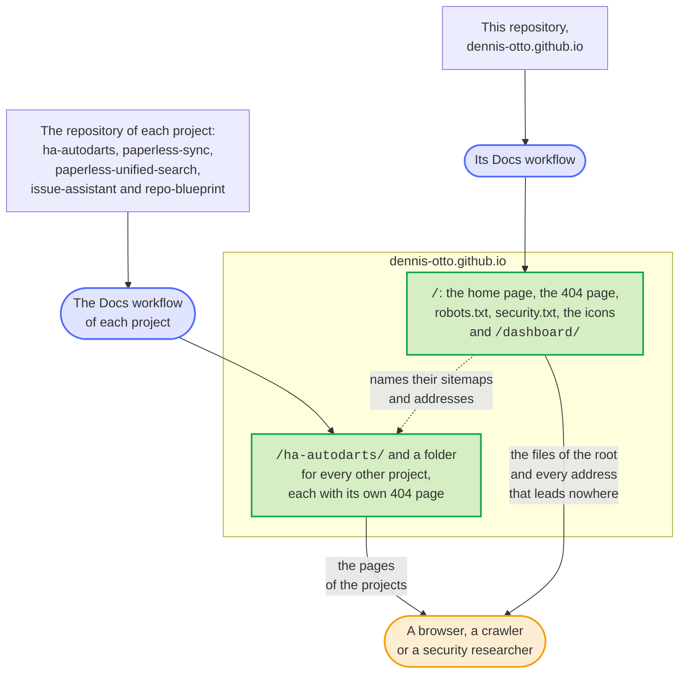

# Dennis Otto

[](https://dennis-otto.github.io/)
[](https://github.com/Dennis-Otto/dennis-otto.github.io/actions/workflows/ci.yml)
[](https://scorecard.dev/viewer/?uri=github.com/Dennis-Otto/dennis-otto.github.io)
[](https://api.reuse.software/info/github.com/Dennis-Otto/dennis-otto.github.io)
[](LICENSE)
[](https://github.com/sponsors/Dennis-Otto)

<a href="https://dennis-otto.github.io/">
  <picture>
    <source media="(prefers-color-scheme: dark)" srcset="docs/images/website-dark.png">
    
  </picture>
</a>

The website of all projects of Dennis Otto, at [dennis-otto.github.io](https://dennis-otto.github.io/): one page with every project, its install button and its documentation, in English and German.

<sub>💛 If the projects are useful to you, you can [support their development](https://github.com/sponsors/Dennis-Otto).</sub>

## The projects

<!-- projects:start -->

| Project | What it does | Start | Website |
| --- | --- | --- | --- |
| [ha-autodarts](https://github.com/Dennis-Otto/ha-autodarts) | Autodarts for Home Assistant, local and in realtime | [Install with HACS](https://my.home-assistant.io/redirect/hacs_repository/?owner=Dennis-Otto&repository=ha-autodarts&category=integration) | [dennis-otto.github.io/ha-autodarts](https://dennis-otto.github.io/ha-autodarts/) · [dennis-otto.github.io/ha-autodarts/de](https://dennis-otto.github.io/ha-autodarts/de/) |
| [paperless-sync](https://github.com/Dennis-Otto/paperless-sync) | Paperless-ngx documents as an archive in Nextcloud | [Nextcloud App Store](https://apps.nextcloud.com/apps/paperless_sync) | [dennis-otto.github.io/paperless-sync](https://dennis-otto.github.io/paperless-sync/) |
| [paperless-unified-search](https://github.com/Dennis-Otto/paperless-unified-search) | The search of Paperless-ngx in the search of Nextcloud | [Nextcloud App Store](https://apps.nextcloud.com/apps/paperless_unified_search) | [dennis-otto.github.io/paperless-unified-search](https://dennis-otto.github.io/paperless-unified-search/) |
| [issue-assistant](https://github.com/Dennis-Otto/issue-assistant) | A GitHub Action that looks after issues | [Use the action](https://github.com/Dennis-Otto/issue-assistant#set-up-a-repository) | [dennis-otto.github.io/issue-assistant](https://dennis-otto.github.io/issue-assistant/) |
| [repo-blueprint](https://github.com/Dennis-Otto/repo-blueprint) | The template all of these repositories are made from | [Start a repository](https://github.com/Dennis-Otto/repo-blueprint#start-a-repository) · [Repository anlegen](https://github.com/Dennis-Otto/repo-blueprint/blob/main/README.de.md#ein-repository-anlegen) | [dennis-otto.github.io/repo-blueprint](https://dennis-otto.github.io/repo-blueprint/) · [dennis-otto.github.io/repo-blueprint/de](https://dennis-otto.github.io/repo-blueprint/de/) |
| Repository dashboard | The state of every repository at a glance | [Dashboard](https://dennis-otto.github.io/repo-blueprint/dashboard/) | — |

<!-- projects:end -->

[dennis-otto.github.io/dashboard](https://dennis-otto.github.io/dashboard/) is the short address of the [dashboard of every repository](https://dennis-otto.github.io/repo-blueprint/dashboard/), which the blueprint builds.

## How the website works

The pages are in [docs/](docs/): `index.md` in English, `index.de.md` in German, `security.md` and `security.de.md` about the security and privacy of the website, which link the decision records, and `dashboard/index.html`, which forwards to the dashboard. MkDocs with the Material theme builds them, and the Docs workflow publishes the website on GitHub Pages with every change of `main`. Preview it while you write, at <http://127.0.0.1:8000>, with the tools of the Docs workflow in a virtual environment of their own, `.venv-docs`, which git ignores:

```sh
python3 -m venv .venv-docs
.venv-docs/bin/pip install --require-hashes -r .github/docs-requirements.txt
.venv-docs/bin/mkdocs serve
```

On Windows, in PowerShell:

```powershell
py -3 -m venv .venv-docs
.venv-docs\Scripts\pip install --require-hashes -r .github/docs-requirements.txt
.venv-docs\Scripts\mkdocs serve
```

These are the commands of [CONTRIBUTING.md](CONTRIBUTING.md#website) and of the head of [mkdocs.yml](mkdocs.yml), and the scripts of [Pictures and icons](#pictures-and-icons) take their tools from the same `.venv-docs`.

The repository comes from the [blueprint](https://github.com/Dennis-Otto/repo-blueprint), whose bot keeps it current.

### The home page

Both home pages name [overrides/home.html](overrides/home.html) as their template. It shows the hero, on the navy of the social previews of the projects: the monogram, the name, a lead sentence and two buttons, *See the projects* and *Sponsor*. The texts of the hero come from the front matter of each page, under `hero:`, so that every language has its own. A landing page has no pencil that edits it, no date of its last change, no menu at its side and no footer that leads to the next page.

Below the hero, the projects stand in groups by their readers, each under a heading of its own: *For the smart home and the document archive* and *For maintainers on GitHub*. Each card has a picture of the project, its name, which links its website, a summary and two buttons, both on one line on a phone: where to start, such as *Install with HACS*, and its documentation. The card of the blueprint leads to the dashboard instead, since its name links the documentation already. A sentence under the Paperless cards explains how the two apps work together. The page loads no diagram: the script of Mermaid would weigh about 1 MB on the most visited page.

### One list of the projects

Every project is written once, in [projects.toml](projects.toml): its group, its name, its texts, its picture and its links, in English and German. While MkDocs builds the website, the hooks in [.github/mkdocs_project.py](.github/mkdocs_project.py) put the groups with a card for each project in place of the line `<!-- projects -->` of both home pages, in the language of the page. The same file writes the table of the projects above, between its two markers:

```sh
python3 -I .github/mkdocs_project.py --write
```

A project without a group, such as the dashboard, has no card of its own: another card names it as its `second` button, and the check fails for a project that no card shows. The same list makes the 404 page, the sitemaps of robots.txt and the structured data of the home page, which [One address, six websites](#one-address-six-websites) describes, so a new project appears there without another edit; [Add a project](#add-a-project) lists the few steps that remain, and [the catalog bot](#the-catalog-bot) opens an issue for a project with a website at the address that the file lacks. The table holds every address of projects.toml, the German ones too, so that the link check, which reads the Markdown files, checks the buttons of the cards as well. `bash scripts/check.sh` fails when the table differs from projects.toml or a project lacks a German text, and the strict build of the website fails when a page or a title of the menu has no German translation.



### The catalog bot

The projects change without this repository: a new one gets its website at `dennis-otto.github.io`, another one translates its documentation, a third is renamed or archived. So every Monday the Catalog workflow, [.github/workflows/catalog.yml](.github/workflows/catalog.yml), compares projects.toml with GitHub and with the websites of the projects, and finds:

- a public repository of the owner with its website in a folder of `dennis-otto.github.io` that has no project in projects.toml;
- a project whose repository was renamed, archived, made private or deleted, or names another website on GitHub;
- a German website that appeared, such as `…/paperless-sync/de/`, while the German home page still leads to the English one, and a German website of projects.toml that answers 404.

It keeps one issue, *The project catalog is out of date*, with what it found and how to fix it, and closes the issue once a run finds projects.toml current. It needs no AI, commits nothing and may only read the repository and write issues; projects.toml stays a change that a person makes and reviews. The comparison needs the standard library alone, so it runs locally too, with the list of the repositories that gh writes:

```sh
gh repo list Dennis-Otto --limit 1000 --json nameWithOwner,homepageUrl,isArchived,isPrivate >repositories.json
python3 -I .github/mkdocs_project.py --network repositories.json
```



### Add a project

A new project, such as one that the catalog bot reports, needs its entry in projects.toml and its pictures; the rest follows from them.

1. Add a `[[project]]` to [projects.toml](projects.toml), where its card belongs: its group, its texts in English and German, its picture and its links. The comments at the top of the file describe every key.
2. Make the picture of its card from the social preview of its repository, and describe what the picture shows in its `alt` texts:

   ```sh
   bash scripts/project-pictures.sh
   ```

3. Write the table of [the projects](#the-projects) anew, with `py -3` in place of `python3` on Windows:

   ```sh
   python3 -I .github/mkdocs_project.py --write
   ```

4. Name the project where the projects are still written by hand: the websites under boundary 4, their number and the table under *Report a vulnerability* of [docs/security.md](docs/security.md) and [docs/security.de.md](docs/security.de.md), and a link to the issues of its repository in the issue chooser, [.github/ISSUE_TEMPLATE/config.yml](.github/ISSUE_TEMPLATE/config.yml). A project with a website of its own also changes the repositories and the number of websites in [One address, six websites](#one-address-six-websites) and in [decision 0002](docs/decisions/0002-the-root-website-owns-the-address.md).
5. Run the checks, look at the card in the [preview](#how-the-website-works), and take the pictures at the top of this README anew:

   ```sh
   bash scripts/check.sh
   bash scripts/screenshots.sh
   ```

6. To show the project in the picture of links to this repository too, add its picture to the collage of [.github/social-preview.html](.github/social-preview.html), run `bash scripts/social-preview.sh` and upload `.github/social-preview.png` under *Settings → General → Social preview*.

The build does the rest: while MkDocs builds the website, the project gets its card on the English and the German home page, its line on the 404 page, its entry in the structured data of the home page and, when its documentation is at `dennis-otto.github.io`, the sitemap of its website in robots.txt. `bash scripts/check.sh` fails when a text lacks its German, the table differs from projects.toml, or the security page or the issue chooser misses the project, and the check *docs* builds the website strictly. Only the number of websites in the texts is checked by no test.

### Pictures and icons

The pictures of the website and of this README come from scripts, so that a new one is a command away and the same input makes the same file, byte for byte. The first three need the tools of the website in `.venv-docs`, which [the preview](#how-the-website-works) sets up, and the last three need Docker.

| Command | What it makes |
| --- | --- |
| `bash scripts/project-pictures.sh` | The picture of every card with a repository, from the social preview of that repository on `main`: a WebP of 640×320 pixels, about 15 KB, in `docs/images/projects/`, with a `.license` file beside it that names the license of the repository for REUSE. Run it when a project has a new social preview, and describe the new picture in its `alt` texts. |
| `bash scripts/icons.sh` | `docs/favicon.ico` with 16, 32 and 48 pixels and `docs/apple-touch-icon.png` with 180, from the monogram in [docs/assets/logo.svg](docs/assets/logo.svg), which is the logo of the header and the icon of the browser tab too. Browsers ask the root of the address for both, for every website at `dennis-otto.github.io`. It renders [.github/icons.html](.github/icons.html) with the Chromium of Playwright in Docker. |
| `bash scripts/screenshots.sh` | The pictures at the top of this README: the home page as a reader first sees it, 1280×800 pixels, as `docs/images/website-light.png` and `docs/images/website-dark.png`. It builds the website strictly and shows it to the Chromium of Playwright in Docker, served on the loopback of the container without a network, once in the light and once in the dark colors, as the theme follows the reader's system. Run it after a change of the home page, of a project or of the theme. The website leaves both pictures out. |
| `bash scripts/social-preview.sh` | `.github/social-preview.png`, the picture of links to this repository, from [.github/social-preview.html](.github/social-preview.html): the monogram and a collage of the pictures of the projects. Upload it under *Settings → General → Social preview*. |

[REUSE.toml](REUSE.toml) gives every file the MIT license of this repository, and REUSE adds that license to the one of a `.license` file instead of replacing it. So `reuse spdx` names both licenses for each picture of a project, until the blueprint, which owns REUSE.toml, lets a `.license` file win.

### One address, six websites

Six repositories publish a website at `dennis-otto.github.io`, each with a Docs workflow of its own. GitHub Pages serves the website of this repository, which is named after the address, at its root, and that of every other repository in a folder named after it, such as `dennis-otto.github.io/ha-autodarts/`. Crawlers, browsers and security researchers look for some files at the root of an address alone, and only this repository can serve them there, so it serves them for all six websites, as [decision 0002](docs/decisions/0002-the-root-website-owns-the-address.md) records.



The hooks in [.github/mkdocs_project.py](.github/mkdocs_project.py) write the files of the root while MkDocs builds the website, and take the projects they name from projects.toml; only the icons come from a script:

| At the root | What it does |
| --- | --- |
| `/robots.txt` | Lets every crawler in and names the sitemap of every website of the address: this one, and that of each project of projects.toml whose documentation is at `dennis-otto.github.io`. |
| `/.well-known/security.txt` and `/security.txt` | Tell security researchers how to report a vulnerability of any of the websites privately, as [RFC 9116](https://www.rfc-editor.org/rfc/rfc9116) describes, and link the [security page](https://dennis-otto.github.io/security.html). The file expires a year after the build, and every change of `main` builds it anew. GitHub Pages publishes the copy under `/.well-known/` once the Docs workflow of the blueprint uploads folders whose names start with a dot. |
| `/favicon.ico` and `/apple-touch-icon.png` | The icons that browsers and phones ask the root of an address for, which [Pictures and icons](#pictures-and-icons) describes. |
| The 404 page | Answers every address that leads nowhere outside the websites of the projects, which have 404 pages of their own: in English and German, with every project, the home page and, for a mistyped project such as `/autodarts/`, *Did you mean Autodarts for Home Assistant?* Its template is [overrides/404.html](overrides/404.html). |
| The structured data of the home page | Search engines take the name of a website from the home page at the root of an address alone, for every page below it. The English home page names the website, its owner and every project with its repository, license and platform, as JSON-LD. Its canonical address, the links between its languages and the sitemaps give the root of the address, `https://dennis-otto.github.io/`, as the website does, rather than `index.html` in it. |

## Development

Every change goes through a pull request whose title follows [Conventional Commits](https://www.conventionalcommits.org/), with signed-off commits (`git commit -s`). The checks of the CI run locally with

```sh
bash scripts/check.sh
```

[CONTRIBUTING.md](CONTRIBUTING.md) explains the set-up and the rules.

## Support and security

A question, a problem or an idea about a project belongs to the issues of its own repository, which the table above links. The [issue chooser](https://github.com/Dennis-Otto/dennis-otto.github.io/issues/new/choose) of this repository links each project's issues too; its own two forms are for the website itself, a problem with a page or an idea for it. The documentation of a project, under `dennis-otto.github.io/<project>/`, is built by the project's repository, and its issues take reports about it. [SUPPORT.md](SUPPORT.md) says what happens with an issue. Report vulnerabilities privately, as [SECURITY.md](SECURITY.md) describes; the [security page](https://dennis-otto.github.io/security.html) links the private report form of every website of the address, and says what the website keeps in the browser, which servers a page asks and which risks remain.


## License

MIT; see [LICENSE](LICENSE). Every file names its license in the machine-readable form of [REUSE](https://reuse.software).
