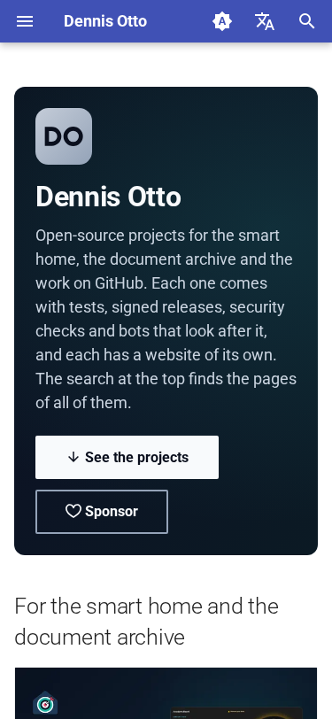
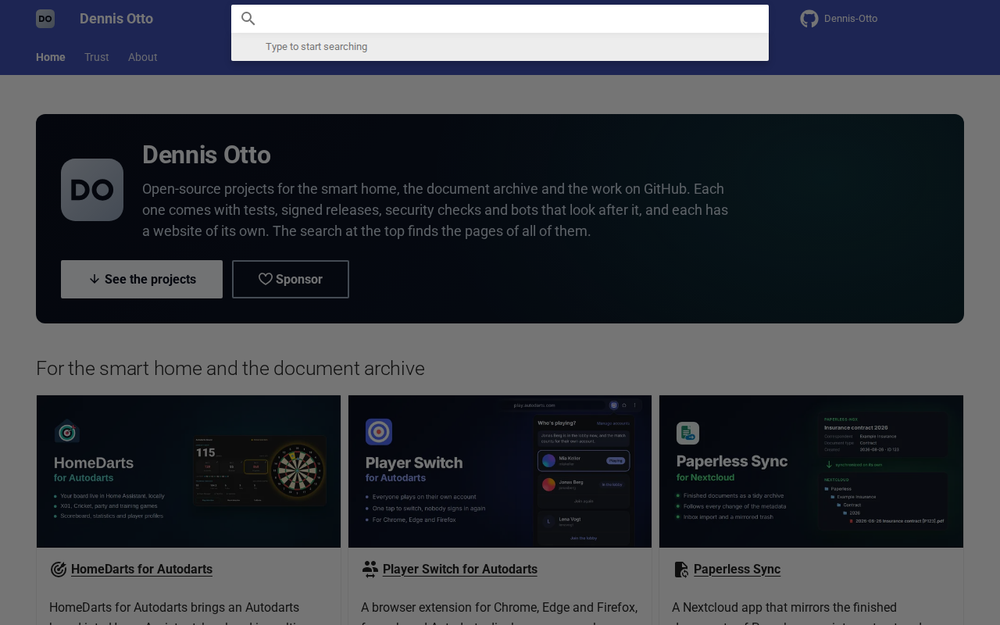
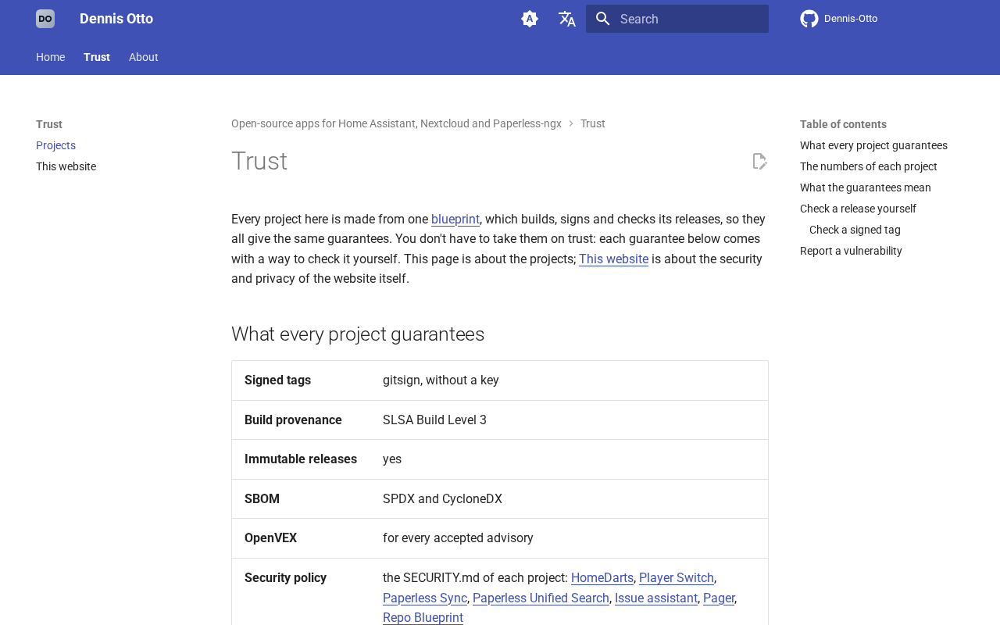

# Dennis Otto

**English** · [Deutsch](README.de.md)

[](https://dennis-otto.github.io/)
[](https://github.com/Dennis-Otto/dennis-otto.github.io/actions/workflows/ci.yml)
[](https://scorecard.dev/viewer/?uri=github.com/Dennis-Otto/dennis-otto.github.io)
[](https://www.bestpractices.dev/projects/16446)
[](https://www.bestpractices.dev/projects/16446)
[](https://api.reuse.software/info/github.com/Dennis-Otto/dennis-otto.github.io)
[](LICENSE)
[](https://dennis-otto.github.io/issue-assistant/)
[](https://github.com/sponsors/Dennis-Otto)

<a href="https://dennis-otto.github.io/">
  <picture>
    <source media="(prefers-color-scheme: dark)" srcset="docs/images/website-dark.png">
    
  </picture>
</a>

The website of all projects of Dennis Otto, at [dennis-otto.github.io](https://dennis-otto.github.io/): one page with every project, its install button and its documentation, in English and German.

<sub>💛 If the projects are useful to you, you can [support their development](https://github.com/sponsors/Dennis-Otto).</sub>

## The projects

<!-- projects:start -->

| Project | What it does | Works with | Start | Website |
| --- | --- | --- | --- | --- |
| [homedarts-for-autodarts](https://github.com/Dennis-Otto/homedarts-for-autodarts) | HomeDarts for Autodarts: Autodarts boards in Home Assistant, local and in realtime | Home Assistant ([hacs.json](https://github.com/Dennis-Otto/homedarts-for-autodarts/blob/HEAD/hacs.json)) | [Install with HACS](https://my.home-assistant.io/redirect/hacs_repository/?owner=Dennis-Otto&repository=homedarts-for-autodarts&category=integration) | [dennis-otto.github.io/homedarts-for-autodarts](https://dennis-otto.github.io/homedarts-for-autodarts/) · [dennis-otto.github.io/homedarts-for-autodarts/de](https://dennis-otto.github.io/homedarts-for-autodarts/de/) |
| [player-switch-for-autodarts](https://github.com/Dennis-Otto/player-switch-for-autodarts) | One shared Autodarts display, everyone on their own account, one tap to switch | Chrome, Edge, Firefox ([extension/manifest.json](https://github.com/Dennis-Otto/player-switch-for-autodarts/blob/HEAD/extension/manifest.json)) | [Add to Chrome](https://chromewebstore.google.com/detail/player-switch-for-autodar/gbijblgchbbbkjeibpjaodflfgbgefam) | [dennis-otto.github.io/player-switch-for-autodarts](https://dennis-otto.github.io/player-switch-for-autodarts/) · [dennis-otto.github.io/player-switch-for-autodarts/de](https://dennis-otto.github.io/player-switch-for-autodarts/de/) |
| [paperless-sync](https://github.com/Dennis-Otto/paperless-sync) | Paperless-ngx documents as an archive in Nextcloud | Nextcloud ([appinfo/info.xml](https://github.com/Dennis-Otto/paperless-sync/blob/HEAD/appinfo/info.xml)) | [Nextcloud App Store](https://apps.nextcloud.com/apps/paperless_sync) | [dennis-otto.github.io/paperless-sync](https://dennis-otto.github.io/paperless-sync/) · [dennis-otto.github.io/paperless-sync/de](https://dennis-otto.github.io/paperless-sync/de/) |
| [paperless-unified-search](https://github.com/Dennis-Otto/paperless-unified-search) | The search of Paperless-ngx in the search of Nextcloud | Nextcloud ([appinfo/info.xml](https://github.com/Dennis-Otto/paperless-unified-search/blob/HEAD/appinfo/info.xml)) | [Nextcloud App Store](https://apps.nextcloud.com/apps/paperless_unified_search) | [dennis-otto.github.io/paperless-unified-search](https://dennis-otto.github.io/paperless-unified-search/) · [dennis-otto.github.io/paperless-unified-search/de](https://dennis-otto.github.io/paperless-unified-search/de/) |
| [issue-assistant](https://github.com/Dennis-Otto/issue-assistant) | A GitHub Action that looks after issues | GitHub Actions and Claude, Codex, Gemini or Copilot | [Use the action](https://dennis-otto.github.io/issue-assistant/getting-started.html#set-up-a-repository) · [Action einsetzen](https://dennis-otto.github.io/issue-assistant/de/getting-started.html#ein-repository-einrichten) | [dennis-otto.github.io/issue-assistant](https://dennis-otto.github.io/issue-assistant/) |
| [repo-pager](https://github.com/Dennis-Otto/repo-pager) | A Telegram bot of your own that tells you only what needs you on GitHub | Cloudflare Workers and Telegram, on their free plans | [Set up](https://dennis-otto.github.io/repo-pager/setup.html) · [Einrichten](https://dennis-otto.github.io/repo-pager/de/setup.html) | [dennis-otto.github.io/repo-pager](https://dennis-otto.github.io/repo-pager/) · [dennis-otto.github.io/repo-pager/de](https://dennis-otto.github.io/repo-pager/de/) |
| [repo-blueprint](https://github.com/Dennis-Otto/repo-blueprint) | The template all of these repositories are made from | Copier ([copier.yml](https://github.com/Dennis-Otto/repo-blueprint/blob/HEAD/copier.yml)) | [Start a repository](https://github.com/Dennis-Otto/repo-blueprint#start-a-repository) · [Repository anlegen](https://github.com/Dennis-Otto/repo-blueprint/blob/main/README.de.md#ein-repository-anlegen) | [dennis-otto.github.io/repo-blueprint](https://dennis-otto.github.io/repo-blueprint/) · [dennis-otto.github.io/repo-blueprint/de](https://dennis-otto.github.io/repo-blueprint/de/) |
| Repository dashboard | The state of every repository at a glance | — | [Dashboard](https://dennis-otto.github.io/repo-blueprint/dashboard/) | — |

<!-- projects:end -->

How they belong together: the tools for maintainers make and look after every repository, and each app serves what it connects to.

<picture>
  <source media="(prefers-color-scheme: dark)" srcset="docs/images/diagrams/how-the-projects-belong-together.dark.svg">
  
</picture>

[dennis-otto.github.io/dashboard](https://dennis-otto.github.io/dashboard/) is the short address of the [dashboard of every repository](https://dennis-otto.github.io/repo-blueprint/dashboard/), which the blueprint builds.

## How the website works

The pages are in [docs/](docs/): `index.md` in English, `index.de.md` in German, `releases.md` and `releases.de.md` with the notes of the latest releases of every project, `trust.md` and `trust.de.md` with the guarantees of every project, `security.md` and `security.de.md` about the security and privacy of the website, `about.md` and `about.de.md` about who builds the projects and how, which link the decision records, and `dashboard/index.html`, which forwards to the dashboard. The menu has three tabs: *Home*, with the Releases page, *Trust*, with the guarantees of the projects and the security page, and *About*, with the page of the same name and the automation of this repository. MkDocs with the Material theme builds them, and the Docs workflow publishes the website on GitHub Pages with every change of `main`. Preview it while you write, at <http://127.0.0.1:8000>, with the tools of the Docs workflow in a virtual environment of their own, `.venv-docs`, which git ignores:

```sh
python3 -m venv .venv-docs
.venv-docs/bin/pip install --require-hashes -r .github/docs-requirements.txt
.venv-docs/bin/mkdocs serve
```

On Windows, in PowerShell:

```powershell
py -3 -m venv .venv-docs
.venv-docs\Scripts\pip install --require-hashes -r .github/docs-requirements.txt
.venv-docs\Scripts\mkdocs serve
```

These are the commands of [CONTRIBUTING.md](CONTRIBUTING.md#website) and of the head of [mkdocs.yml](mkdocs.yml), and the scripts of [Pictures and icons](#pictures-and-icons) take their tools from the same `.venv-docs`.

The repository comes from the [blueprint](https://github.com/Dennis-Otto/repo-blueprint), whose bot keeps it current.

### The home page

Both home pages name [overrides/home.html](overrides/home.html) as their template. It shows the hero, on the navy of the social previews of the projects: the monogram, the name, a lead sentence and two buttons, *See the projects* and *Sponsor*. The texts of the hero come from the front matter of each page, under `hero:`, so that every language has its own. A landing page has no pencil that edits it, no date of its last change, no menu at its side and no footer that leads to the next page.

Below the hero, the projects stand in groups by their readers, each under a heading of its own: *For the smart home and the document archive* and *For maintainers on GitHub*. Each card has a picture of the project in the language of the page, its name, which links its website, a summary, a line that says what it works with, such as *Works with Home Assistant 2026.8.0 or newer*, and two buttons below it, both on one line on a phone: where to start, such as *Install with HACS*, and its documentation. The card of the blueprint leads to the dashboard instead, since its name links the documentation already. A sentence under the Paperless cards explains how the two apps work together. Every card of a project shows its [live facts](#live-facts), its latest release and the numbers of its quality, and *What's new* below the groups lists the latest release of every project, the newest first, each with the headline of its notes, and leads to the [Releases page](#the-releases-page). The pictures of the first group, which a reader sees as the page opens, load at once, the first before every other picture of the page, since it is the largest thing the page paints; those further down load as they come into view. Until a picture is there, its place has its size and the navy of the pictures, so no white box flashes in either color scheme. The page loads no diagram: the script of Mermaid would weigh about 1 MB on the most visited page.

On a phone, the hero fills the first screen: the menu folds into the button at the top left, the buttons of the color scheme, the language and the search stay in the header, and the buttons of the hero stand one below the other.

<picture>
  <source media="(prefers-color-scheme: dark)" srcset="docs/images/website-phone-dark.webp">
  
</picture>

### One list of the projects

Every project is written once, in [projects.toml](projects.toml): its group, its name, its texts, its picture and its links, in English and German. While MkDocs builds the website, the hooks in [.github/mkdocs_project.py](.github/mkdocs_project.py) put the groups with a card for each project in place of the line `<!-- projects -->` of both home pages, in the language of the page. The same file writes the table of the projects above, between its two markers, and the German one of [README.de.md](README.de.md), with the German texts and the German addresses first:

```sh
python3 -I .github/mkdocs_project.py --write
```

A project without a group, such as the dashboard, has no card of its own: another card names it as its `second` button, and the check fails for a project that no card shows. The same list makes the 404 page, the sitemaps of robots.txt, llms.txt and the structured data of the home page, which [One address, every website](#one-address-every-website) describes, so a new project appears there without another edit; [Add a project](#add-a-project) lists the few steps that remain, and [the catalog bot](#the-catalog-bot) opens an issue for a project with a website at the address that the file lacks. The table holds every address of projects.toml, the German ones too, so that the link check, which reads the Markdown files, checks the buttons of the cards as well. `bash scripts/check.sh` fails when the table differs from projects.toml or a project lacks a German text, and on a pull request a table that differs [fixes itself](#the-checks-of-this-website), and the strict build of the website fails when a page or a title of the menu has no German translation.

<picture>
  <source media="(prefers-color-scheme: dark)" srcset="docs/images/diagrams/one-list-of-the-projects.dark.svg">
  
</picture>

### The catalog bot

The projects change without this repository: a new one gets its website at `dennis-otto.github.io`, another one translates its documentation, a third is renamed or archived. So every Monday the Catalog workflow, [.github/workflows/catalog.yml](.github/workflows/catalog.yml), compares projects.toml with GitHub and with the websites of the projects, and finds:

- a public repository of the owner with its website in a folder of `dennis-otto.github.io` that has no project in projects.toml;
- a project whose repository was renamed, archived, made private or deleted, or names another website on GitHub;
- a German website that appeared, such as `…/paperless-sync/de/`, while the German home page still leads to the English one, and a German website of projects.toml that answers 404;
- a file from which a card reads what its project works with, such as `hacs.json`, that is gone from the default branch of its repository on `raw.githubusercontent.com`, or that holds no version in its field any more, before the next release takes the line off the card;
- a screenshot or a logo from which the hub draws the German picture of a card, as `drawing` in projects.toml names it, that is gone from the default branch of its repository, before the next run of [the screenshot bot](#the-pictures-renew-themselves) stops at it;
- a color of the light behind that screenshot, `drawing.accent`, that the social preview of the repository lacks, its source `.github/social-preview.html` on the default branch, so that the German picture glows in another color than the English one, which is that preview; the issue names the `--accent` of the preview where it has one, and the bot sets that one itself, as below.

What the published website depends on after its build, the bot watches every day, as [the watch of the live websites](#the-watch-of-the-live-websites) describes.

It keeps one issue, *The project catalog is out of date*, with what it found and how to fix it, and closes the issue once a run finds projects.toml current. It needs no AI. A run started by hand from another branch than `main`, such as `gh workflow run catalog.yml --ref <branch>` to try a change of the bot, writes what it found into the summary of its run alone: the issue and the pull request say what `main` needs, so it changes neither, and the watch does the same with its own issue.

A difference with one correct edit needs no person to write it, only one to merge it. The bot makes these edits itself, after it asked the web for each address and read the social preview of each repository:

- a German website that appeared: `docs.en` and `docs.de` in place of `docs`;
- a German website that is gone, beside an English one that answers: one `docs` in place of `docs.en` and `docs.de`;
- a website that its repository names in another folder of the address, which answers, where the folder of the catalog is gone: the new address in every language. Such a move also needs `former` for the readers who still come to the old folder, and the tests that name the folder, which a person pushes onto the branch of the pull request.
- a drawn picture whose light, `drawing.accent`, is a color that the social preview of its repository lacks, where the preview names one `--accent`, the same wherever it names it: that accent. The light changes no other file, and the merge brings the new picture: projects.toml is among the files whose change on `main` starts [the screenshot bot](#the-pictures-renew-themselves), which draws the German picture anew in its own pull request.

The edit changes only the lines of the address or the line of the light, inside the `[[project]]` of its slug, with every comment and the order of the file as they were, and it is made only if the file reads back as the wanted catalog. After an address, the tables of the READMEs, the links of the pages of the website and the data of the tests of the script of the not-found page follow, so that the checks of the pull request pass. The bot keeps one pull request from the branch `bot/catalog` with them, marks those differences in the issue and names the pull request there; it closes the pull request when `main` needs no edit any more, and leaves one with a commit of a person alone. Everything else stays in the issue for a person: a repository that was renamed, archived, made private or is new, a file that a card or a picture needs, a second website that answers beside the one of the catalog, a website that is away altogether, and a light whose social preview names no `--accent` of its own or two different ones, so that only a person can choose among its colors.

The comparison may only read the repository and write issues, holds no secret, and commits nothing. Only the job that follows it, *catalog pull request*, has the release app, so that the checks of the pull request run: it asks the app for what a branch and a pull request need alone, checks out only its own script, [scripts/catalog-pull-request.sh](scripts/catalog-pull-request.sh), from the commit of `main` that the run compared, runs nothing that the comparison made, and commits only projects.toml, the READMEs, the pages of the website and that data. The tests in `tests/test_catalog_pull_request.py` run that script in bash against a fake gh, with the real jq, for each way it can go: a new pull request, an update of an open one, one with a commit of a person, one of a fork, a file outside what it commits, and no edits with or without an open pull request. Without the app, the issue still says each edit. Harden-Runner blocks every host but those of the steps of a job, `api.github.com`, `github.com`, `dennis-otto.github.io`, `raw.githubusercontent.com` and the store of the artifacts for the comparison, `api.github.com`, `github.com` and the store of the artifacts for the pull request (and `api.github.com` alone for the daily build), and the hosts of GitHub that the runner itself needs, and takes sudo and Docker away, so a compromised dependency or action can't send a token anywhere outside GitHub and `dennis-otto.github.io`. The comparison needs the standard library alone, so it runs locally too, with the list of the repositories that gh writes, and `--fix` makes the edits in your copy, with the text of their pull request in the file that it names:

```sh
gh repo list Dennis-Otto --limit 1000 --json nameWithOwner,homepageUrl,isArchived,isPrivate >repositories.json
python3 -I .github/mkdocs_project.py --network repositories.json
python3 -I .github/mkdocs_project.py --network repositories.json --fix pull-request.md
```

<picture>
  <source media="(prefers-color-scheme: dark)" srcset="docs/images/diagrams/the-catalog-bot.dark.svg">
  
</picture>

#### The watch of the live websites

The checks of a pull request and [the check of the built website](#the-check-of-the-built-website) test what a build writes. Once it is published, the website depends on things that change without this repository and that no build checks again: the data of the dashboard, which the blueprint publishes every two hours and from which the cards take their [live facts](#live-facts), the search indexes of the project websites, which the next build takes into [the search](#one-search-for-every-website), and the files that only the daily build keeps current. A change there degrades the website without a sign, by design: the cards keep the facts of the build, and a project website without its index drops out of the search. So every day at 06:17 UTC, after the daily build, the job *watch* of the Catalog workflow asks the live websites, and finds:

- `repos.json` or `history.json` of the dashboard that is gone or no JSON, has another `schema` than the one that the script knows, lacks a field that the script reads or holds a value of another kind, such as a score as a text, as [.github/dashboard-fields.json](.github/dashboard-fields.json) names them, a `repos.json` whose `generated`, the time at which the dashboard wrote it, is missing, no time with its zone or more than 24 hours old, though the dashboard writes it every two hours, so that a dashboard that stopped publishing without a failed run shows within a day instead of old releases and scores for days, and a project with a card that `repos.json` has no entry for;
- a project website whose search index answers 404, isn't one of Material for MkDocs or holds no entry, before the next build leaves the website out of the search;
- a project with a repository whose release notes the Releases page lacks, so that *What's new* leaves it out, and a project website that the search index of this website has no entry of: a build that can't read the API of GitHub or the index of a project website passes and says so only in its log, its summary and a warning of the run, so that a loss that lasts, such as of a token that no longer reaches the hooks, would otherwise go unseen; each line asks for a rebuild, after a look at the log;
- a copy of `security.txt` that is missing or holds for 330 days or fewer, though every build renews it to 365, so that a daily build that stopped shows within a month instead of after a year; `robots.txt` without the sitemap of a website of the address; and the sitemap of this website without the root of the address;
- an old address of `former/<folder>.txt` that answers 404 or doesn't lead to the same page in the new folder, and one whose page there answers 404, because its project moved or removed the page.

It keeps one issue, *The live websites need attention*, with the label `maintenance`, in which every line names the address, what readers lose and the fix, writes the same into the summary of its run, and closes the issue once a run finds nothing. An address that can't be reached is asked twice, and one that still can't be reached or answers oddly fails the run without touching the issue, as the catalog bot does. Harden-Runner lets the job reach `api.github.com`, `github.com` and `dennis-otto.github.io` alone, and takes sudo and Docker away. The watch needs the standard library alone, so it runs locally too, and `gh workflow run catalog.yml -f job=watch` starts it at once:

```sh
python3 -I .github/mkdocs_project.py --watch
```

<picture>
  <source media="(prefers-color-scheme: dark)" srcset="docs/images/diagrams/the-watch-of-the-live-websites.dark.svg">
  
</picture>

### Add a project

A new project, such as one that the catalog bot reports, needs its entry in projects.toml and its pictures; the rest follows from them.

1. Add a `[[project]]` to [projects.toml](projects.toml), where its card belongs: its group, its texts in English and German, its picture and its links, what it works with in `requires`, best from the file of its repository that holds the versions, and for a project whose releases carry a package, its `asset`, which the commands of the Trust page check. The comments at the top of the file describe every key.
2. Make the pictures of its card, and write its `alt` texts as those of the other cards: with the name of the project and what every picture keeps, as [the pictures renew themselves](#the-pictures-renew-themselves) from then on. The English picture comes from the social preview of its repository; for the German one, give it `image.de` and a `drawing` with a screenshot of its repository, in German where it has one, its logo and the color of its social preview, and `drawing.hangs = true` for a screenshot that is cut at its foot already, such as a popup below the toolbar of a browser, and the script draws it:

   ```sh
   bash scripts/project-pictures.sh
   ```

3. Write the table of [the projects](#the-projects) anew, with `py -3` in place of `python3` on Windows; a pull request from a branch of this repository without it gets the table from [the fix bot](#the-checks-of-this-website), one from a fork does not:

   ```sh
   python3 -I .github/mkdocs_project.py --write
   ```

4. Name the project where the projects are still written by hand: the websites under boundary 4 and the table under *Report a vulnerability* of [docs/security.md](docs/security.md) and [docs/security.de.md](docs/security.de.md), a link to the issues of its repository in the issue chooser, [.github/ISSUE_TEMPLATE/config.yml](.github/ISSUE_TEMPLATE/config.yml), and a node with its slug as its id in the map of the projects, [docs/diagrams/how-the-projects-belong-together.mmd](docs/diagrams/how-the-projects-belong-together.mmd) and its German translation, where it belongs, whose pictures `bash scripts/diagrams.sh` draws, or the diagram bot after a push; `python3 -I .github/mkdocs_project.py --check` fails while a source lacks the node of a project. No other text lists the projects or says how many websites there are, so a new project changes nothing else, and an accepted decision record stays as it is; a test fails on a number of websites in the texts.
5. Run the checks and look at the card in the [preview](#how-the-website-works). The screenshot bot takes the pictures at the top of this README anew once the change is on `main`, and `bash scripts/screenshots.sh` shows them before. When the project joins the first group of the home page, or the hero changed, describe what the pictures show in the `alt` of the picture at the top of this README; a test checks that it names the first group and each of its projects:

   ```sh
   bash scripts/check.sh
   bash scripts/screenshots.sh
   ```

6. To show the project in the picture of links to this repository too, add its picture to the collage of [.github/social-preview.html](.github/social-preview.html), run `bash scripts/social-preview.sh` and upload `.github/social-preview.png` under *Settings → General → Social preview*.

A project whose repository is renamed follows [Rename a project](#rename-a-project) instead.

The build does the rest: while MkDocs builds the website, the project gets its card on the English and the German home page, its row of numbers, its links to its security policy and its form for private reports, and its commands on the Trust page, its line on the 404 page, its entry in the structured data of the home page, its line in llms.txt and, when its documentation is at `dennis-otto.github.io`, the sitemap of its website in robots.txt and its guides in llms.txt. `bash scripts/check.sh` fails when a text lacks its German, the table differs from projects.toml, the security page, the issue chooser or the `alt` of the picture at the top of this README misses the project, or a text names a number of websites, and the check *docs* builds the website strictly.

### Rename a project

GitHub Pages publishes the website of a renamed repository in the folder of its new name and leaves nothing in the old one, whose addresses then reach this website, as every address does that no project serves. So this website keeps them working, as [decision 0004](docs/decisions/0004-the-root-website-keeps-the-old-addresses-of-a-renamed-project.md) records:

1. Change the entry of the project in [projects.toml](projects.toml): its `slug`, `repo`, `start` and `docs`, and its texts, its `asset` and its picture where they change, as in [Add a project](#add-a-project).
2. Name the old folder of its website in `former`, such as `former = ["ha-autodarts"]` for HomeDarts for Autodarts, and list the pages of the old website in `former/<folder>.txt`, from its sitemap, before the repository is renamed. With the name of the old folder in `folder`:

   ```sh
   folder=ha-autodarts
   curl -fsS "https://dennis-otto.github.io/$folder/sitemap.xml" |
     grep -oE "https://dennis-otto\.github\.io/$folder/[^<\"]*" |
     sed -e "s#^https://dennis-otto.github.io/$folder/##" -e 's#^$#index.html#' -e 's#/$#/index.html#' |
     sort -u
   ```

3. Write the table of [the projects](#the-projects) anew, name the project by its new name in the lists of step 4 of [Add a project](#add-a-project), and run the checks.

While MkDocs builds the website, the hooks write a page at every old address of the list, such as `/ha-autodarts/de/games.html`, which leads to the same page in the new folder at once, with the query and the fragment of the address, such as `#cricket`; without JavaScript, its refresh and its link lead there. It names the new address as its canonical one and asks search engines to list no page of its own. The 404 page leads every other address of the old folder, such as that of a picture or of a page that the old website added after its list, to the same path in the new folder, and the card of the project keeps the anchor of the old folder, such as `/#ha-autodarts`. `bash scripts/check.sh` and the build fail for a folder of `former` that the address or the home page uses already, as a language, the folder of a website, a slug or the id of a group, and for a list of old pages that is missing or holds a line that is no path of a page; the strict build fails when this website puts a file of its own into such a folder.

The pages wait behind the website of the project until its repository is renamed, since GitHub Pages serves a folder of a project before this website, so the change can come before the rename. Never give a new repository an old name: its website would hide the pages again, and GitHub would stop sending the address of the old repository to the renamed one.

### Pictures and icons

The pictures of the website and of this README come from scripts, so that a new one is a command away and the same input makes the same file, byte for byte, on every machine: Docker runs the same amd64 build of Playwright's image on ARM too, emulated. The first three need the tools of the website in `.venv-docs`, which [the preview](#how-the-website-works) sets up, and all of them need Docker.

| Command | What it makes |
| --- | --- |
| `bash scripts/project-pictures.sh` | The pictures of every card with a repository, in both languages: WebPs of 640×320 pixels, about 15 KB each, in `docs/images/projects/`, each with a `.license` file beside it that names the license of the repository for REUSE. The English one, such as `paperless-sync.webp`, comes from the social preview of the repository on its default branch. The previews speak English alone, so the script draws the German one, such as `de/paperless-sync.webp`, in their look: the Chromium of Playwright in Docker renders [.github/card-picture.html](.github/card-picture.html) with the logo, the name and the German tagline of the project beside the screenshot of its repository that `drawing` in projects.toml names, in German where the project has one, inside a frame or, with `drawing.hangs`, hanging from the top. `scripts/screenshots.sh` runs it first, so the screenshot bot renews the pictures on its own; run it yourself for the pictures of a new card. |
| `bash scripts/icons.sh` | `docs/favicon.ico` with 16, 32 and 48 pixels and `docs/apple-touch-icon.png` with 180, from the monogram in [docs/assets/logo.svg](docs/assets/logo.svg), which is the logo of the header and the icon of the browser tab too. Browsers ask the root of the address for both, for every website at `dennis-otto.github.io`. It renders [.github/icons.html](.github/icons.html) with the Chromium of Playwright in Docker. |
| `bash scripts/screenshots.sh` | The pictures of the cards, with `scripts/project-pictures.sh` first, and those of the website in this README and on the About pages, each in the light and in the dark colors, as a reader first sees it: the home page at 1280×800 pixels, `docs/images/website-light.png` and `website-dark.png` at the top of this README, and the German one, `website-light.de.webp` and `website-dark.de.webp`, at the top of [README.de.md](README.de.md); the [home page on a phone](#the-home-page), 375×812, and the [Trust page](#the-trust-page) as lossless WebPs, `website-phone-*.webp` and `website-trust-*.webp`; and [the search of every project](#one-search-for-every-website) as an animated WebP that plays once and stays on its last frame, `search-*.webp`, with that frame as the still for a reader who prefers reduced motion, `search-still-*.webp`, and the same of the German home page as `search-*.de.webp` and `search-still-*.de.webp`, which the German About page shows at the addresses of the English ones. It builds the website strictly, serves it on the loopback of a container of Playwright's image without a network, and [scripts/screenshots.py](scripts/screenshots.py) drives the headless Chromium of the image through the DevTools protocol, with the standard library of Python alone: each picture in a browser context of its own, in its size, its color scheme and with reduced motion, taken once the page has settled, and the search typed a letter at a time, a frame for each. Pillow from `.venv-docs` turns the screenshots into the WebPs. The screenshot bot runs it on its own; run it yourself to see what a change of the home page, of a project or of the theme changes, and describe what the pictures show in their `alt`, the one at the top of this README when the first group changes. The website leaves out the pictures that only the READMEs show, `website-*`. |
| `bash scripts/social-preview.sh` | `.github/social-preview.png`, the picture of links to this repository, from [.github/social-preview.html](.github/social-preview.html): the monogram and a collage of the pictures of the projects. Upload it under *Settings → General → Social preview*. |

[REUSE.toml](REUSE.toml) gives every file the MIT license of this repository, and REUSE adds that license to the one of a `.license` file instead of replacing it. So `reuse spdx` names both licenses for each picture of a project, until the blueprint, which owns REUSE.toml, lets a `.license` file win.

#### The pictures renew themselves

The projects renew their social previews and screenshots on their own, and the pictures of the cards and of this README follow without a person. The screenshot bot of the blueprint, [.github/workflows/screenshot-bot.yml](.github/workflows/screenshot-bot.yml), runs `bash scripts/screenshots.sh` every Friday, after every release of this repository, when started by hand, and after every change of `main` that touches a file of [.github/screenshots-paths.txt](.github/screenshots-paths.txt): projects.toml, the scripts of the pictures and the page from which it draws the German pictures of the cards, and what makes the home page and the Trust page, their pages, templates, styles, scripts, logo and hooks. The script first runs `bash scripts/project-pictures.sh`, so that every card gets the social preview that the repository of its project has on its default branch in English, and in German a picture drawn anew with the screenshot of the repository on its default branch, and then takes the pictures of the website in this README and on the About pages with these cards: the home page on a desktop and on a phone, the Trust page and the search of every project. The [catalog bot](#the-catalog-bot) reports every week a screenshot or a logo that a repository no longer has, before a run of the script stops at it.

The bot compares each picture with the one of `main` by its pixels and keeps the committed file of every picture that looks the same, so a run without a new preview, a new screenshot or a change of the home page changes nothing. When pixels changed, one pull request from `bot/screenshots`, *docs: update the screenshots*, brings the new pictures with the share of the pixels that changed in each, and merges itself once every check passes. A new preview or screenshot reaches the website within a week, or at once after a start by hand:

```sh
gh workflow run screenshot-bot.yml
```

The `alt` texts of the cards in projects.toml say what every picture keeps: the icon and the name of the project and what it does, beside a picture of the project, and in German whether that screenshot is in German. They leave out what that picture shows today, such as the score of a game of darts, which the next preview may change, and a test checks that each one names its project.

Only the picture of links to this repository itself, `.github/social-preview.png`, stays a step for a person: it is a collage of the pictures of the cards, and GitHub takes it only as an upload under *Settings → General → Social preview*, so after new card pictures run `bash scripts/social-preview.sh` and upload it, as step 6 of [Add a project](#add-a-project) says.

<picture>
  <source media="(prefers-color-scheme: dark)" srcset="docs/images/diagrams/the-pictures-renew-themselves.dark.svg">
  
</picture>

### One address, every website

This repository and those of the projects publish their websites at `dennis-otto.github.io`, each with a Docs workflow of its own. GitHub Pages serves the website of this repository, which is named after the address, at its root, and that of every other repository in a folder named after it, such as `dennis-otto.github.io/homedarts-for-autodarts/`. Crawlers, browsers and security researchers look for some files at the root of an address alone, and only this repository can serve them there, so it serves them for every website at the address, as [decision 0002](docs/decisions/0002-the-root-website-owns-the-address.md) records.

<picture>
  <source media="(prefers-color-scheme: dark)" srcset="docs/images/diagrams/one-address-every-website.dark.svg">
  
</picture>

The hooks in [.github/hub/address.py](.github/hub/address.py) write the files of the root while MkDocs builds the website, and take the projects they name from projects.toml; only the icons come from a script:

| At the root | What it does |
| --- | --- |
| `/robots.txt` | Lets every crawler in and names the sitemap of every website of the address: this one, and that of each project of projects.toml whose documentation is at `dennis-otto.github.io`. |
| `/llms.txt` | The map of every website of the address for AI assistants, in Markdown as [llmstxt.org](https://llmstxt.org/) describes it, so that an assistant asked *how do I bring my Autodarts board into Home Assistant?* finds the installation of HomeDarts. It has a section for each group of the home page with its projects, each with its tagline, its website, the first button of its card and the pages of its website that readers look for first: getting started, installation, setup, guide, help, how it works, a shared display, FAQ and troubleshooting, each with its German page, and none twice where the first button leads to one of them already. The hooks take those pages from the search index of each website, which [the search](#one-search-for-every-website) downloads anyway, and never a decision record; a website that is away for one build lists its pages again with the next. |
| `/.well-known/security.txt` and `/security.txt` | Tell security researchers how to report a vulnerability of any of the websites privately, as [RFC 9116](https://www.rfc-editor.org/rfc/rfc9116) describes, and link the [security page](https://dennis-otto.github.io/security.html). The file expires a year after the build, and every change of `main` and [the daily build](#one-search-for-every-website) make it anew. GitHub Pages publishes the copy under `/.well-known/` once the Docs workflow of the blueprint uploads folders whose names start with a dot. |
| `/favicon.ico` and `/apple-touch-icon.png` | The icons that browsers and phones ask the root of an address for, which [Pictures and icons](#pictures-and-icons) describes. |
| The 404 page | Answers every address that leads nowhere outside the websites of the projects, which have 404 pages of their own: in English and German, with every project, the home page and, for a mistyped project such as `/autodarts/`, *Did you mean HomeDarts for Autodarts?* An address in the old folder of a renamed project leads to the same path in its new folder. Its template is [overrides/404.html](overrides/404.html), and its script [overrides/partials/not-found.js](overrides/partials/not-found.js). |
| The old addresses of a renamed project | A page at every address of the old website of a project whose repository was renamed, such as `/ha-autodarts/games.html`, which leads to the same page of its website now, as [Rename a project](#rename-a-project) describes. |
| The structured data of the home page | Search engines take the name of a website from the home page at the root of an address alone, for every page below it. The English home page names the website, its owner and every project with its repository, license and platform, as JSON-LD. Its canonical address, the links between its languages and the sitemaps give the root of the address, `https://dennis-otto.github.io/`, as the website does, rather than `index.html` in it. |

### One search for every website

The search box of this website finds the pages of every project website too: *Cricket* finds the games of HomeDarts for Autodarts, and *archive account* the guide of Paperless Sync. On the home page, *token* finds the API token of Paperless Unified Search, the sealed tokens of Player Switch and the token of the superuser in Paperless Sync, each under the short name of its project, as the animation below shows, and a result opens the page on the website of its project. A reader who prefers reduced motion sees its last frame alone.

<picture>
  <source media="(prefers-reduced-motion: reduce) and (prefers-color-scheme: dark)" srcset="docs/images/search-still-dark.webp">
  <source media="(prefers-reduced-motion: reduce)" srcset="docs/images/search-still-light.webp">
  <source media="(prefers-color-scheme: dark)" srcset="docs/images/search-dark.webp">
  
</picture>

After MkDocs has built the website, the hooks in [.github/hub/search.py](.github/hub/search.py) download the search index of every project of projects.toml whose documentation lies in a folder of the address, such as `/homedarts-for-autodarts/search/search_index.json`, and add its pages and sections to `/search/search_index.json`, the one index of both languages of this website:

- Every location moves into the folder of its project, so that a result opens the page on the website of the project, in its language.
- Every title of a page starts with the short name of its project and `›`, such as *HomeDarts › Games and rules*: `short` in projects.toml, or its `name`. The sections stand under their page, as on the website of the project.
- Every text becomes an excerpt: plain text without its tags and its blocks of code, such as the source of a diagram, cut after a whole word at 200 characters at most and escaped, so that an index can carry no markup into this website.
- Every entry gets a rank from the name of its page, in every language, such as `installation.html` and `de/installation.html`. First comes the entry of every page, with its title and its text before the first heading; then the sections of the pages that a reader looks for first, `getting-started`, `install`, `installation`, `setup`, `guide`, `help`, `how-it-works`, `shared-display`, `faq` and `troubleshooting`, such as the help and the shared display of Player Switch and the setup and how it works of Repo Pager; then the sections of those pages in a further language of their website, such as `de/faq.html` or `nl/faq.html`, so that a FAQ in five languages never pushes the help of a smaller website out; then those of the other pages; and last those of the pages for maintainers, `changelog`, `releases`, `development`, `automation` and `roadmap`. A decision record, a page in a folder named `decisions`, keeps the entry of its page and none of its sections.
- The projects add 120,000 bytes at most, packed with gzip as GitHub Pages sends the index. The budget gives up the entries of the last rank first, and the entries of the pages last: of the sections of a rank, the page with the most gives up its last ones first, such as the oldest releases of a changelog, and of the pages, the largest website gives up its last ones first. So the search finds every page of every project in both languages: in November 2026 the projects added all of their 544 pages and 1,098 of their sections, 114 KB, among them every section of the help of Player Switch and of the setup of Repo Pager, and left out the sections of the decision records and of the pages for maintainers. The log of every build says how many pages and sections of each website the search keeps, so that a drop shows there.
- The search of Material for MkDocs ranks the matches of an entry by its `boost`: the pages that a reader looks for first and their sections count twice, those for maintainers and the decision records half, also the decision records of this website, so that *installation* finds the installation of HomeDarts before a decision record that mentions it. A project website's own boosts stay on that website.
- Every page asks for the index only when the reader goes to the search box, or a second after the page has loaded, when the browser is idle: [overrides/partials/search-hold.js](overrides/partials/search-hold.js), which [overrides/main.html](overrides/main.html) puts into every page, holds back the request of Material for MkDocs, which would otherwise share a slow connection with the fonts and the pictures of the first paint. With it, Lighthouse rates the home page on a phone 0.95 to 0.98, as without the projects in the search.

A download may take 10 seconds and is tried twice, 2 seconds apart, or as long as the answer asks, as the API of GitHub does with `Retry-After` or the moment at which its limit of requests resets, when that is 30 seconds away at most; for a longer wait the build goes on without the file at once, and all downloads of a build wait 2 minutes together at most, well within the 5 minutes of the step. A project website that can't be downloaded, or whose index isn't one, stays out of the search until the next build, and the log of the build says why without a warning, so the strict build passes while a project website is away. The summary of the run of the Docs workflow shows the same as a table, with a row for each project website: how many of its pages and sections the search keeps, or why it left the website out. And [the watch of the live websites](#the-watch-of-the-live-websites) asks every project website for its index every day, so that one whose index stays away gets an issue. Every day at 04:41 UTC the Catalog workflow starts the Docs workflow on `main`, which builds and publishes the website again, so the search follows the documentation of the projects within a day. To build it at once, run `gh workflow run catalog.yml -f job=rebuild`.

<picture>
  <source media="(prefers-color-scheme: dark)" srcset="docs/images/diagrams/one-search-for-every-website.dark.svg">
  
</picture>

### Live facts

Every card of a project shows what sets the project apart, as numbers that a reader can check: its latest release and how long ago it came out, the share of its code that its tests run, the share of mutants of its code that they catch, the score of its repository in the [OpenSSF Scorecard](https://scorecard.dev/), the median time to the first answer by a person to a new issue, and the level that it holds in the [OpenSSF Best Practices](https://www.bestpractices.dev/). *What's new*, below the groups, lists the latest release of every project, the newest first, each with the headline of its notes, such as *HomeDarts for Autodarts v2.0.1 · 3 days ago* and *Ask Assist about your darts sounds more natural in German, Spanish, French and Dutch*, linked to its notes on the [Releases page](#the-releases-page). In German, the texts and the numbers are German too, such as *vor 3 Tagen* and *100 % Testabdeckung*.

- **The release and the numbers come from the dashboard.** Every two hours the [dashboard of the blueprint](https://dennis-otto.github.io/repo-blueprint/dashboard/) publishes its data beside itself, at the same address as this website: `repos.json`, with the latest release and the numbers of every repository, `history.json`, with the numbers of every day, and `releases.atom`, the feed of the releases of all projects. As a home page loads, [docs/javascripts/projects.js](docs/javascripts/projects.js) reads `repos.json`, or the numbers of the latest day of `history.json` when it can't, and writes them into the cards in the language of the page. So the numbers stay current without a new build of the website, and the page asks no other server, needs no token and meets no limit of an API. The script reads only the shape of `repos.json` that it knows, its `schema` 1, writes every text with `textContent`, and links only addresses on GitHub.
- **The level of the OpenSSF Best Practices comes from the build.** The hooks in [.github/hub/render.py](.github/hub/render.py) read it from bestpractices.dev for every project that names its number there, `bestpractices` in projects.toml, and write it into its card, linked to its page; the Catalog workflow builds the website every day. The website shows no badge: the privacy plugin would keep it as the build downloaded it, so the hooks of the blueprint take every badge out of a page. A level that can't be read stays off the card until the next build, which passes.
- **What's new comes from the build, and the script keeps it current.** The hooks write the latest release of every project with the headline of its notes, without the scope of a commit in front, such as `deps:`, from the releases that they read for the [Releases page](#the-releases-page), as many as projects.toml has projects with a repository. A release of maintenance alone says so, *Maintenance release* or *Wartungsrelease* as `maintenance` of `[facts]` in projects.toml has it, rather than read like a changelog for the maintainer: every pull request that its notes list has the scope `ci`, `build`, `test`, `refactor`, `style` or `chore`, or `deps` or `docs` while no line of the notes says in the words of a user what that changes. As the page loads, the script puts a newer release of `repos.json` in the place of one that came out after the build, linked to its notes on GitHub, and tells the day of every release as the time since, such as *3 days ago*.
- **Without the data or without the script,** every card keeps what the build wrote into it, and *What's new* the releases of the build, each with its day as a date, and its sentence, which links the Releases page, the dashboard and the feed. The head of the home pages names no feed: Material asks the folder of every alternate link there for a `sitemap.xml`, which the dashboard doesn't publish, so the link would cost every reader a failed request.
- **The shape of the data is watched.** Since the cards keep the facts of the build when the data changes its shape, nobody would see that the live facts are gone. [.github/dashboard-fields.json](.github/dashboard-fields.json) names what the script reads: the `schema` of `repos.json` that it knows, and the kind of every field of an entry, of its `health` and of a day of `history.json`, such as `released`, a day or null, and in `feed` the fields of `repos.json` itself that the script does without and the watch alone reads, `generated`, a time. The tests of the script fail when it reads a field that the file doesn't name or knows another schema, and [the watch of the live websites](#the-watch-of-the-live-websites) checks the live data against the file every day.
- **What a project works with comes from its latest release.** The first question of a visitor who wants to install is whether a project runs on their system, so every card says it right above its buttons, as an app store says it beside its button to install: *Works with Home Assistant 2026.8.0 or newer*, *Nextcloud 33 to 35 and Paperless-ngx* or *Copier 9.8 or newer*, *Funktioniert mit …* in German. The `requires` of a project in projects.toml names the file of its repository that holds the versions and the field of each, such as `homeassistant` of `hacs.json`, `dependencies/nextcloud@min-version` of `appinfo/info.xml` or `_min_copier_version` of `copier.yml`, and the hooks read the file at the tag of the latest release of the build from `raw.githubusercontent.com`, which needs no token, so the card follows the next release on its own. A version of one number and a zero, such as the `140.0` of Firefox in the manifest of Player Switch, reads as that number, *Firefox 140*, as Chrome writes its own and Mozilla names the release. A project whose file holds no version, such as the issue assistant, a GitHub Action, or the pager, a Cloudflare Worker, says it in a text of its own. A file or a value that can't be read leaves the line off the card until the next build, which passes, and [the catalog bot](#the-catalog-bot) reports a file or a field that is gone from the default branch before a release takes the line off. The table of [the projects](#the-projects) names the file of each, and the structured data of the home page names what it works with as the `runtimePlatform` of its code.
- **The texts** of the facts, in English and German, are in `[facts]` of projects.toml, with `{}` where a value goes, such as `{} test coverage`, and those of the line of what a project works with in `[requirements]`; the comments at the top of the file describe each.
- **The Trust page** takes the same release and numbers from the same data into its table of the numbers of each project, as described [below](#the-trust-page).

`bash scripts/check-project.sh` runs the tests of the script with Node 22.8 or newer, on a document of their own and with the data of the dashboard in [tests/fixtures/repos.json](tests/fixtures/repos.json), as [the tests of the scripts](#the-tests-of-the-scripts) describes, and the CI runs them on every pull request. [Decision 0003](docs/decisions/0003-the-home-pages-take-their-live-facts-from-the-dashboard.md) says why the facts come from the dashboard.

<picture>
  <source media="(prefers-color-scheme: dark)" srcset="docs/images/diagrams/the-live-facts.dark.svg">
  
</picture>

### The Releases page

[The Releases page](https://dennis-otto.github.io/releases.html), *Neuigkeiten* in German, shows what changed in every project: the notes of its latest five releases, the newest first, under a heading of each project, in the words of its users, as its changelog has them. A row of links at the top and the table of contents lead to each project, also without JavaScript; the search finds the notes; and the page links the feed of all releases for a feed reader, and below the releases of each project, beside the link to all of them on GitHub, the feed of that project alone, `https://github.com/<repo>/releases.atom`. The hooks write it in place of the line `<!-- release-notes -->` of `docs/releases.md` and `docs/releases.de.md`:

- **The notes come from the API of GitHub at the build.** For every project with a repository, the hooks ask `api.github.com/repos/<repo>/releases` once a build, for both languages, for the HTML that GitHub makes of the Markdown of the notes, and leave out drafts and prereleases, such as the betas for testers. The Catalog workflow builds the website every day. A release that came out since, the script adds as the page loads, from `repos.json` of the dashboard, under the heading of its project, with a link to its notes on GitHub. A token in `GITHUB_TOKEN` or `GH_TOKEN`, where one is set, lifts the limit of the API from 60 requests an hour to 5,000; the hooks send it to the API alone, never to a host that the API leads on to.
- **No HTML of a release reaches the page as it is.** Of the notes, the page keeps text, paragraphs, lists, headings, tables, code, quotes and links to `https://` addresses, without an attribute but the address of a link: no script, no style, no picture, no frame and no form. The notes take the place of their placeholder in the HTML of the page, after Markdown, so no extension of Markdown reads them, such as the snippets that include a file. Their headings stand below the heading of their release, a heading in front that names the version is left out, and a line break that GitHub makes of every line of their Markdown becomes a space.
- **The notes for users, once.** Below the notes for users, the release bot of the blueprint lists every pull request of the release under the heading *Every pull request of this release*: the same changes again, as the subjects of their commits. The page leaves that list to the link of each release on GitHub, so a reader, a screen reader and the search meet each change once. Notes with nothing above that heading keep the list, and *What's new* still reads it, to tell a release of maintenance by the scopes of its pull requests.
- **Dated by its releases.** The sitemap and the date of the last change of a page take the last commit of its Markdown, while the Releases pages and the home pages, with *What's new*, change with every release of a project. The hooks date these pages by the newest release that the build read, when it came out later, so a search engine reads from the sitemap that they changed, and the Releases page shows that date as its last change; `--site` fails the check when the sitemap dates a page before the newest release that it shows.
- **Without the API,** as on a computer without a network or when its limit is reached, the build passes, and the page keeps the heading of every project with a link to its releases on GitHub; *What's new* leaves its place to the script, as before, and the card has no *Works with* until the next build. So that it never goes unseen, the summary of the run of the Docs workflow shows a table with a row for each repository, how many of its releases the page has or why it has none, and [the check of the built website](#the-check-of-the-built-website) warns of every project whose releases the build couldn't read, with an annotation of the run.
- **The notes stay in English,** the language of the changelogs, also on the German page, which names their language for screen readers. Each language has a search index of its own, so the German index holds the English notes once, from the German page, and the search finds them in both languages.
- **The texts** of the page, the name of the row of links, the link of each release to GitHub and the link to all releases of a project, are in `[facts]` of projects.toml, in English and German.

<picture>
  <source media="(prefers-color-scheme: dark)" srcset="docs/images/diagrams/the-releases-page.dark.svg">
  
</picture>

The tests of the hooks build the page from releases whose notes hold a script, a picture, a frame and a link to `javascript:`, and check that none of them reaches it; those of the script add a newer release to a Releases page of their own. [Decision 0005](docs/decisions/0005-the-releases-page-takes-the-notes-from-the-api-at-the-build.md) says why the notes come from the API of GitHub at the build.

### The Trust page

[The Trust page](https://dennis-otto.github.io/trust.html) shows the guarantees of every project with a repository and the commands that check them. The hooks write the guarantees from the texts of `[trust]` in projects.toml into `docs/trust.md` and `docs/trust.de.md`, in two parts under a heading each of the page itself, in place of the lines `<!-- trust-shared -->` and `<!-- trust -->`, so that the page reads on a phone without scrolling sideways:

- **What every project guarantees** lists each guarantee that every project gives alike once, with its one value in `[trust]`: signed tags, build provenance, immutable releases, SBOM, OpenVEX, the security policy and the private reports. Each holds for every project made from the blueprint, as its SECURITY.md says, so change such a claim only once every SECURITY.md has changed. The value of the last two holds `{}`, where the hooks link the SECURITY.md and the form for private reports of each project, under its short name.
- **The numbers of each project** is a table with a row for each project, under its short name, which links its website, and a column for each number. Its live columns, the latest release, the test coverage, the mutation score and the OpenSSF Scorecard, come from the dashboard as on the cards: the page names [overrides/facts.html](overrides/facts.html) as its template, which loads [docs/javascripts/projects.js](docs/javascripts/projects.js), as the home pages do through it. The script writes each value alone into its cell, such as *100%* or *7.8*. Without the data or without the script, the cell of the release links the releases of the project on GitHub, and the others show a dash. The level of the OpenSSF Best Practices comes from the build, as on the cards.
- **On a phone or a narrow tablet,** narrower than 45em, where the table wouldn't fit, each project becomes a card of its own, with the label of each number, the `data-label` of its cell, beside its value, and the guarantees stand below their labels. Wider, the table keeps the column of the projects in place when it scrolls sideways in its frame.
- **The commands** take the place of the line `<!-- verify -->`, a tab for each project: `gh release verify` checks the attestation of its latest release, and `gh attestation verify` the provenance of the file that its users install, `asset` in projects.toml, such as `homedarts.zip`, or of its SBOM, such as `repo-blueprint.spdx.json`, when it ships no package, with the options of the SECURITY.md of every project: `--signer-workflow` for its release workflow, `--source-ref refs/heads/main` for a run for `main` and `--deny-self-hosted-runners` for a runner of GitHub. A package with the version in its name takes a pattern with one `*` for the version, such as `player-switch-for-autodarts-*.zip`: `gh release download` gets the pattern in double quotes, which no shell expands, and saves the file as `player-switch-for-autodarts.zip`, the name that `gh attestation verify` checks. Each command stands on a line of its own and names no tag, so it runs in any shell as copied and checks the latest release. A test compares the options with the SECURITY.md of this repository, which comes from the blueprint like those of the projects, so that the commands can't fall behind the policy.

<picture>
  <source media="(prefers-color-scheme: dark)" srcset="docs/images/website-trust-dark.webp">
  
</picture>

The tests of the hooks check both parts, that each shared guarantee appears once, and the commands, and those of the script fill a table of the numbers of their own. Run the commands once against the latest release of every project after a change of them.

## Development

Every change goes through a pull request whose title follows [Conventional Commits](https://www.conventionalcommits.org/), with signed-off commits (`git commit -s`). The checks of the CI run locally with

```sh
bash scripts/check.sh
```

[CONTRIBUTING.md](CONTRIBUTING.md) explains the set-up and the rules.

### Coding standards

The code of this website follows the standards of the blueprint for its languages, beside those that [CONTRIBUTING.md](CONTRIBUTING.md#coding-standards) names for the shell scripts, the workflows, the Markdown and every text file:

- **Python**, the hooks in `.github/mkdocs_project.py` and `.github/hub/`, `scripts/screenshots.py` and the tests, follows [PEP 8](https://peps.python.org/pep-0008/) in the format of [Ruff](https://docs.astral.sh/ruff/), which matches Black, with the rules of Ruff that [ruff.toml](ruff.toml) selects, those of the blueprint: pycodestyle, Pyflakes, isort, flake8-bugbear, pyupgrade, flake8-simplify, flake8-pytest-style and the rules of Ruff itself. The code has type hints, which mypy checks in its strict mode with [mypy.ini](mypy.ini), and runs on Python 3.11 or newer.
- **JavaScript**, the scripts that the browser runs from `docs/javascripts/` and `overrides/partials/` and their tests in `tests/`, follows the format and the recommended rules of [Biome](https://biomejs.dev/), with sorted imports and the indentation of `.editorconfig`, as [biome.jsonc](biome.jsonc) sets them up, the settings of the JavaScript projects of the blueprint. The scripts are classic scripts in strict mode, without a step that builds them.

`bash scripts/check-project.sh` checks both, as [the checks of this website](#the-checks-of-this-website) say, with the tools of `requirements-test.txt` and `tests/lint/package-lock.json`, and `bash scripts/check-project.sh --fix` fixes what Ruff and Biome can. The code of the blueprint in `.github/`, such as `.github/blueprint/`, keeps the settings of the blueprint, which checks it there. An exception to a rule is rare and has its reason in a comment at its place, as in `ruff.toml` and `biome.jsonc`.

### The code of the hooks

MkDocs, the scripts and the workflows all run one file, [.github/mkdocs_project.py](.github/mkdocs_project.py), which passes on what they ask for. The code is in the package [.github/hub/](.github/hub/), with nothing but the standard library: a module for each concern, each with its tests in `tests/test_hub_<module>.py`. A module imports only those below it in this picture, and its first lines say what it does, so a change needs one module in view and not the whole code.

<picture>
  <source media="(prefers-color-scheme: dark)" srcset="docs/images/diagrams/the-code-of-the-hooks.dark.svg">
  
</picture>

### The checks of this website

`bash scripts/check.sh` runs [scripts/check-project.sh](scripts/check-project.sh) last, with the five checks of this website alone, each under its heading after `==`:

| Heading | What it checks |
| --- | --- |
| Tests of the scripts of the website, with every line, branch and function covered | [The tests of the scripts](#the-tests-of-the-scripts) that the website runs in the browser of a visitor, with Node.js. |
| The format and the rules of the JavaScript | That those scripts and their tests are in the format of Biome and keep its rules, as [the coding standards](#coding-standards) name them. |
| The projects of projects.toml in the READMEs | That projects.toml has every text, the German ones too, that [the table of the projects](#the-projects), and the German one of [README.de.md](README.de.md), are those that `.github/mkdocs_project.py --write` writes from it, and that the map of the projects below it has a node of each in both languages. |
| The format, the rules and the types of the Python | That the hooks, `scripts/screenshots.py` and the tests are in the format of Ruff, keep the rules of `ruff.toml` and pass mypy in its strict mode, as [the coding standards](#coding-standards) name them. |
| Tests of the hooks of the website, with every line and branch covered | The tests of [.github/mkdocs_project.py](.github/mkdocs_project.py) and of its code in [.github/hub/](.github/hub/) in `tests/`, with pytest and the coverage of every line and branch. |

When one of them fails, the PR coach explains it in the words of [.github/checks.project.toml](.github/checks.project.toml), which win over the general ones of the blueprint: what each heading means, why it matters and the commands that fix it, in the summary of the check, in its comment on the pull request and, on your machine, in the output of `scripts/check.sh`. A table that differs from projects.toml, and code that Biome or Ruff can fix, fix themselves: the job of the check runs `python3 -I .github/mkdocs_project.py --write` and `bash scripts/check-project.sh --fix`, and after the checks the fix bot commits what they changed onto the branch of the pull request, and the checks run again. On a pull request from a fork the bot can only suggest lines that the pull request already changes, and one that edits only projects.toml leaves the READMEs alone, so there run the same commands on your machine and push. A test that fails, a line that no test runs, a type that mypy rejects or a rule that no tool can fix needs a person. [tests/test_checks_project.py](tests/test_checks_project.py) keeps the explanation in step with the script: it fails when a heading of the script is missing from it, or when its autofix is no longer the commands that write the table and fix the code.

<picture>
  <source media="(prefers-color-scheme: dark)" srcset="docs/images/diagrams/the-checks-of-this-website.dark.svg">
  
</picture>

### The tests of the scripts

The website runs three scripts of its own in the browser of a visitor. Each is a file with its tests in `tests/`, which run it as the browser does, in a context of its own with a page, an address and the requests of the browser made for the test, so they need Node.js 22.8 or newer and no package:

| Script | What it does in the browser | Its tests |
| --- | --- | --- |
| [docs/javascripts/projects.js](docs/javascripts/projects.js) | Writes the [live facts](#live-facts) into the home pages, the Trust page and the Releases page; [overrides/facts.html](overrides/facts.html) loads it there. | [tests/projects.test.mjs](tests/projects.test.mjs) |
| [overrides/partials/not-found.js](overrides/partials/not-found.js) | Leads an address in the old folder of a renamed project to the same path in its new folder, with its query and its fragment, and suggests a project for every other address that leads nowhere. [overrides/404.html](overrides/404.html) puts it inline into the 404 page, with its data as JSON, `#not-found-data`, from projects.toml. It leads to and links only the addresses of its data at https, each written anew from its encoded parts, so that broken data can't lead a reader to a `javascript:` address. | [tests/not-found.test.mjs](tests/not-found.test.mjs) |
| [overrides/partials/search-hold.js](overrides/partials/search-hold.js) | Holds back the [search index](#one-search-for-every-website) until the reader goes to the search box, or until the browser is idle after the page has loaded. [overrides/main.html](overrides/main.html) puts it inline into every page, before the scripts of the theme. | [tests/search-hold.test.mjs](tests/search-hold.test.mjs) |

The two scripts of `overrides/partials/` are inline, so that a page asks for no further file, and Jinja reads them as part of the template: their tests check that neither holds `{{`, `{%`, `{#` or the end tag of a script, and that the templates include them and nothing else. `mkdocs.yml` leaves them out of the website as files of their own. Run the tests as `bash scripts/check-project.sh` does:

```sh
node --test --experimental-test-coverage \
  --test-coverage-include='docs/javascripts/*.js' --test-coverage-include='overrides/partials/*.js' \
  --test-coverage-lines=100 --test-coverage-branches=100 --test-coverage-functions=100 \
  tests/*.test.mjs
```

The step fails when the tests leave a line, a branch or a function of a script out, and names its lines. Node measures only the scripts that a test loads, so [tests/scripts.test.mjs](tests/scripts.test.mjs) also fails for a script without its own `tests/<name>.test.mjs`; the coverage table at its end shows each script. The CI logs the version of Node it runs them with, and fails without Node 22.8 or newer; a computer without it leaves the tests to the CI and says so.

### The check of the built website

The tests of the hooks fake MkDocs and its plugins, so they can't see what a new version of Material or of mkdocs-static-i18n changes in the real build, such as the order in which the plugins write their files. So after the strict build, the check *docs* runs [scripts/check-site.sh](scripts/check-site.sh) with the folder of the website, `site`. It checks there what the hooks in [.github/mkdocs_project.py](.github/mkdocs_project.py) promise in the files that they alone write or change after the build, beside what `blueprint.py site-check` checks for the hooks that every website shares, and then uses [the hub in a browser](#the-hub-in-a-browser), each part under its heading after `==` in the log:

<picture>
  <source media="(prefers-color-scheme: dark)" srcset="docs/images/diagrams/the-check-of-the-built-website.dark.svg">
  
</picture>

| In the website | What the check expects |
| --- | --- |
| `/.well-known/security.txt` and `/security.txt` | The same text in both, as [RFC 9116](https://www.rfc-editor.org/rfc/rfc9116) asks: a `Contact` of `https://`, `mailto:` or `tel:`, one `Expires` after the check and less than a year ahead, a `Canonical` for both addresses, and a `Policy` that is a page of the website. |
| `/robots.txt` | One `Sitemap:` for this website and for every project of projects.toml whose documentation is at the address. |
| `/llms.txt` | As [llmstxt.org](https://llmstxt.org/) asks, the title `# Dennis Otto` on its first line and lists of links alone in its sections; a section for every group of projects.toml, the website and the first button of every project, every page of this website that it links, and no decision record. |
| Every `sitemap.xml` and `/sitemap.xml.gz` | The root of the address for the English home page, never `index.html` in it, and for a page with releases, such as the Releases page, a last change no older than the newest release that it shows. |
| The old addresses | A page at every address of `former/<folder>.txt`, whose canonical address and refresh lead to the same page in the folder of the website now. |
| `/404.html` | The old folders in the data of its script, `#not-found-data`, which leads every other address of an old folder to the new one. |
| `/index.html` and `/de/index.html` | A card for every project with a group, with its picture, whose file is in the website, and the anchors of its old folders; the English one also the JSON-LD with every project with a repository, in the order of projects.toml. |
| `/releases.html` and `/de/releases.html` | The place of the releases of every project with a repository under its heading, and a warning for each whose releases the API of GitHub refused the build, which fails nothing. |
| `/search/search_index.json` | An entry for every page of this website that its sitemap lists, the boosts that the hooks give them, which shows that the hooks wrote the index last, and the entries of the project websites, each in the folder of its website. |

Each broken promise is a line with the file and the fix, and in the CI an annotation of the check; GitHub Pages then publishes nothing, since the job that builds the website hands it over only when every step has passed. A warning, such as the releases of a project that the API refused the build, is a line and a warning annotation too, and the check passes, as the next build brings them. The search fails only when it has no entry of any project website, which a project website that is away for one build can't cause; when GitHub Pages was away for all of them, the job passes when it runs again. To check a build on your machine with the tools of [the preview](#how-the-website-works):

```sh
.venv-docs/bin/mkdocs build --strict
bash scripts/check-site.sh site
```

### The hub in a browser

The tests of the scripts run each script alone, on a page of their own, and the check of the built website reads its files, so neither sees whether the parts work together with the JavaScript of Material in a browser, which a new version of Material can change: its search, the order of its scripts or the HTML of its pages. So after its check of the files, `scripts/check-site.sh` opens the built website in Google Chrome with [tests/e2e/hub.mjs](tests/e2e/hub.mjs), in the light scheme at the width of a phone, 390 pixels, and of a desktop, 1280 pixels, and uses it as a reader does:

<picture>
  <source media="(prefers-color-scheme: dark)" srcset="docs/images/diagrams/the-hub-in-a-browser.dark.svg">
  
</picture>

| Scenario | What the reader does | What it needs |
| --- | --- | --- |
| The search finds a project website | Types a word into the search of the home page that only the pages of project websites have, which the test takes from the search index of the page, and gets a result that leads to one of them. The page asks for the index only after it has loaded. | The merged index of the hooks, Material's search and its worker, and the hold of `overrides/partials/search-hold.js`, as [One search for every website](#one-search-for-every-website) explains. |
| The old addresses lead to the new folder | Opens the old folder of a renamed project, `/ha-autodarts/`, a page of `former/ha-autodarts.txt` and an address that the old website never had, each with a query and a fragment, and lands on the same path in the new folder, `/homedarts-for-autodarts/`, with both. | The pages that the hooks write at the old addresses, and the moves that `overrides/partials/not-found.js` makes on the 404 page, as [Rename a project](#rename-a-project) explains. |
| The 404 page suggests a project | Opens `/homedarts/`, the first word of the folder of the first project, and reads *Did you mean HomeDarts for Autodarts?* and *Meintest du HomeDarts for Autodarts?*, each with the link of its language. | The 404 page, the data of its script, `#not-found-data`, from projects.toml, and the script. |
| The live facts fill the cards and the Trust table | Sees the release of each project of the data of the dashboard on its card of the home page and in the table of the Trust page. | `docs/javascripts/projects.js` and the places that the hooks write for it, as [Live facts](#live-facts) explains. |
| The language switch leads to the German home page | Chooses *Deutsch* in the header of the home page and lands on the German one. | The language switch of Material and the sitemaps of the hooks. |
| The path names the website first and no page twice | Sees no path above the hero of the home page, and on the Releases, Trust and Roadmap pages one that starts with *Dennis Otto* and leads nowhere twice. | `overrides/partials/path.html` in place of the path of Material, and `path` under `hide` in `docs/index.md` and `docs/index.de.md`. |

The twelve runs, six scenarios at two widths, take a few seconds together, each in a browser of its own. They read nothing from the network: every request to the address gets the answer of GitHub Pages, a file of `site` or its 404 page with the status 404, the data of the dashboard at `/repo-blueprint/dashboard/repos.json` comes from [tests/fixtures/repos.json](tests/fixtures/repos.json), which the tests of `projects.js` read too, a page of a project website is a stand-in, and a request to another server is refused, and the log names its server. A scenario that fails names its title, the width and what broke, with the file that does it, in the log, as an annotation and in the summary of the check, and keeps a screenshot and a trace of Playwright in `site/.e2e/`, such as `search-phone.png` and `search-phone.zip`. The artifact *website* of a pull request holds them (a push to `main` uploads no artifact, so a failure there is reproduced with the commands below), and [trace.playwright.dev](https://trace.playwright.dev) opens a trace in the browser, without sending it anywhere, with every step and the page as it looked; the PR coach explains the check in the words of [.github/checks.project.toml](.github/checks.project.toml), with every scenario by its title, which [tests/test_checks_project.py](tests/test_checks_project.py) keeps in step with the script.

`scripts/check-site.sh` runs them after the build above with Node.js 20 or newer and Google Chrome; `CHROME=/path/to/chrome` names another Chrome or Chromium. It installs `playwright-core` from [tests/e2e/package-lock.json](tests/e2e/package-lock.json), which Renovate keeps current, and again when the lock file changes. Without Node or Chrome, it says so and leaves the scenarios to the CI, where a missing one fails the check. To run the scenarios alone, after a build:

```sh
npm ci --prefix tests/e2e --ignore-scripts
node tests/e2e/hub.mjs site
```

## Support and security

A question, a problem or an idea about a project belongs to the issues of its own repository, which the table above links. The [issue chooser](https://github.com/Dennis-Otto/dennis-otto.github.io/issues/new/choose) of this repository links each project's issues too; its own two forms are for the website itself, a problem with a page or an idea for it. The documentation of a project, under `dennis-otto.github.io/<project>/`, is built by the project's repository, and its issues take reports about it. [SUPPORT.md](SUPPORT.md) says what happens with an issue. Report vulnerabilities privately, as [SECURITY.md](SECURITY.md) describes; the [security page](https://dennis-otto.github.io/security.html) links the private report form of every website of the address, and says what the website keeps in the browser, which servers a page asks and which risks remain.

<picture>
  <source media="(prefers-color-scheme: dark)" srcset="docs/images/diagrams/where-an-issue-goes.dark.svg">
  
</picture>

## License

MIT; see [LICENSE](LICENSE). Every file names its license in the machine-readable form of [REUSE](https://reuse.software).
