# Dennis Otto

[](https://dennis-otto.github.io/)
[](https://github.com/Dennis-Otto/dennis-otto.github.io/actions/workflows/ci.yml)
[](https://scorecard.dev/viewer/?uri=github.com/Dennis-Otto/dennis-otto.github.io)
[](https://api.reuse.software/info/github.com/Dennis-Otto/dennis-otto.github.io)
[](LICENSE)
[](https://github.com/sponsors/Dennis-Otto)

<a href="https://dennis-otto.github.io/">
  <picture>
    <source media="(prefers-color-scheme: dark)" srcset="docs/images/website-dark.png">
    
  </picture>
</a>

The website of all projects of Dennis Otto, at [dennis-otto.github.io](https://dennis-otto.github.io/): one page with every project, its install button and its documentation, in English and German.

<sub>💛 If the projects are useful to you, you can [support their development](https://github.com/sponsors/Dennis-Otto).</sub>

## The projects

<!-- projects:start -->

| Project | What it does | Works with | Start | Website |
| --- | --- | --- | --- | --- |
| [homedarts-for-autodarts](https://github.com/Dennis-Otto/homedarts-for-autodarts) | HomeDarts for Autodarts: Autodarts boards in Home Assistant, local and in realtime | Home Assistant ([hacs.json](https://github.com/Dennis-Otto/homedarts-for-autodarts/blob/HEAD/hacs.json)) | [Install with HACS](https://my.home-assistant.io/redirect/hacs_repository/?owner=Dennis-Otto&repository=homedarts-for-autodarts&category=integration) | [dennis-otto.github.io/homedarts-for-autodarts](https://dennis-otto.github.io/homedarts-for-autodarts/) · [dennis-otto.github.io/homedarts-for-autodarts/de](https://dennis-otto.github.io/homedarts-for-autodarts/de/) |
| [player-switch-for-autodarts](https://github.com/Dennis-Otto/player-switch-for-autodarts) | One shared Autodarts display, everyone on their own account, one tap to switch | Google Chrome on the desktop | [Install](https://github.com/Dennis-Otto/player-switch-for-autodarts#quick-start) | [dennis-otto.github.io/player-switch-for-autodarts](https://dennis-otto.github.io/player-switch-for-autodarts/) · [dennis-otto.github.io/player-switch-for-autodarts/de](https://dennis-otto.github.io/player-switch-for-autodarts/de/) |
| [paperless-sync](https://github.com/Dennis-Otto/paperless-sync) | Paperless-ngx documents as an archive in Nextcloud | Nextcloud ([appinfo/info.xml](https://github.com/Dennis-Otto/paperless-sync/blob/HEAD/appinfo/info.xml)) | [Nextcloud App Store](https://apps.nextcloud.com/apps/paperless_sync) | [dennis-otto.github.io/paperless-sync](https://dennis-otto.github.io/paperless-sync/) · [dennis-otto.github.io/paperless-sync/de](https://dennis-otto.github.io/paperless-sync/de/) |
| [paperless-unified-search](https://github.com/Dennis-Otto/paperless-unified-search) | The search of Paperless-ngx in the search of Nextcloud | Nextcloud ([appinfo/info.xml](https://github.com/Dennis-Otto/paperless-unified-search/blob/HEAD/appinfo/info.xml)) | [Nextcloud App Store](https://apps.nextcloud.com/apps/paperless_unified_search) | [dennis-otto.github.io/paperless-unified-search](https://dennis-otto.github.io/paperless-unified-search/) · [dennis-otto.github.io/paperless-unified-search/de](https://dennis-otto.github.io/paperless-unified-search/de/) |
| [issue-assistant](https://github.com/Dennis-Otto/issue-assistant) | A GitHub Action that looks after issues | GitHub Actions and Claude, Codex, Gemini or Copilot | [Use the action](https://github.com/Dennis-Otto/issue-assistant#set-up-a-repository) | [dennis-otto.github.io/issue-assistant](https://dennis-otto.github.io/issue-assistant/) |
| [repo-blueprint](https://github.com/Dennis-Otto/repo-blueprint) | The template all of these repositories are made from | Copier ([copier.yml](https://github.com/Dennis-Otto/repo-blueprint/blob/HEAD/copier.yml)) | [Start a repository](https://github.com/Dennis-Otto/repo-blueprint#start-a-repository) · [Repository anlegen](https://github.com/Dennis-Otto/repo-blueprint/blob/main/README.de.md#ein-repository-anlegen) | [dennis-otto.github.io/repo-blueprint](https://dennis-otto.github.io/repo-blueprint/) · [dennis-otto.github.io/repo-blueprint/de](https://dennis-otto.github.io/repo-blueprint/de/) |
| Repository dashboard | The state of every repository at a glance | — | [Dashboard](https://dennis-otto.github.io/repo-blueprint/dashboard/) | — |

<!-- projects:end -->

[dennis-otto.github.io/dashboard](https://dennis-otto.github.io/dashboard/) is the short address of the [dashboard of every repository](https://dennis-otto.github.io/repo-blueprint/dashboard/), which the blueprint builds.

## How the website works

The pages are in [docs/](docs/): `index.md` in English, `index.de.md` in German, `releases.md` and `releases.de.md` with the notes of the latest releases of every project, `trust.md` and `trust.de.md` with the guarantees of every project, `security.md` and `security.de.md` about the security and privacy of the website, `about.md` and `about.de.md` about who builds the projects and how, which link the decision records, and `dashboard/index.html`, which forwards to the dashboard. The menu has three tabs: *Home*, with the Releases page, *Trust*, with the guarantees of the projects and the security page, and *About*, with the page of the same name and the automation of this repository. MkDocs with the Material theme builds them, and the Docs workflow publishes the website on GitHub Pages with every change of `main`. Preview it while you write, at <http://127.0.0.1:8000>, with the tools of the Docs workflow in a virtual environment of their own, `.venv-docs`, which git ignores:

```sh
python3 -m venv .venv-docs
.venv-docs/bin/pip install --require-hashes -r .github/docs-requirements.txt
.venv-docs/bin/mkdocs serve
```

On Windows, in PowerShell:

```powershell
py -3 -m venv .venv-docs
.venv-docs\Scripts\pip install --require-hashes -r .github/docs-requirements.txt
.venv-docs\Scripts\mkdocs serve
```

These are the commands of [CONTRIBUTING.md](CONTRIBUTING.md#website) and of the head of [mkdocs.yml](mkdocs.yml), and the scripts of [Pictures and icons](#pictures-and-icons) take their tools from the same `.venv-docs`.

The repository comes from the [blueprint](https://github.com/Dennis-Otto/repo-blueprint), whose bot keeps it current.

### The home page

Both home pages name [overrides/home.html](overrides/home.html) as their template. It shows the hero, on the navy of the social previews of the projects: the monogram, the name, a lead sentence and two buttons, *See the projects* and *Sponsor*. The texts of the hero come from the front matter of each page, under `hero:`, so that every language has its own. A landing page has no pencil that edits it, no date of its last change, no menu at its side and no footer that leads to the next page.

Below the hero, the projects stand in groups by their readers, each under a heading of its own: *For the smart home and the document archive* and *For maintainers on GitHub*. Each card has a picture of the project, its name, which links its website, a summary, a line that says what it works with, such as *Works with Home Assistant 2026.8.0 or newer*, and two buttons below it, both on one line on a phone: where to start, such as *Install with HACS*, and its documentation. The card of the blueprint leads to the dashboard instead, since its name links the documentation already. A sentence under the Paperless cards explains how the two apps work together. Every card of a project shows its [live facts](#live-facts), its latest release and the numbers of its quality, and *What's new* below the groups lists the latest release of every project, the newest first, each with the headline of its notes, and leads to the [Releases page](#the-releases-page). The page loads no diagram: the script of Mermaid would weigh about 1 MB on the most visited page.

### One list of the projects

Every project is written once, in [projects.toml](projects.toml): its group, its name, its texts, its picture and its links, in English and German. While MkDocs builds the website, the hooks in [.github/mkdocs_project.py](.github/mkdocs_project.py) put the groups with a card for each project in place of the line `<!-- projects -->` of both home pages, in the language of the page. The same file writes the table of the projects above, between its two markers:

```sh
python3 -I .github/mkdocs_project.py --write
```

A project without a group, such as the dashboard, has no card of its own: another card names it as its `second` button, and the check fails for a project that no card shows. The same list makes the 404 page, the sitemaps of robots.txt and the structured data of the home page, which [One address, every website](#one-address-every-website) describes, so a new project appears there without another edit; [Add a project](#add-a-project) lists the few steps that remain, and [the catalog bot](#the-catalog-bot) opens an issue for a project with a website at the address that the file lacks. The table holds every address of projects.toml, the German ones too, so that the link check, which reads the Markdown files, checks the buttons of the cards as well. `bash scripts/check.sh` fails when the table differs from projects.toml or a project lacks a German text, and on a pull request a table that differs [fixes itself](#the-checks-of-this-website), and the strict build of the website fails when a page or a title of the menu has no German translation.

<picture>
  <source media="(prefers-color-scheme: dark)" srcset="docs/images/diagrams/one-list-of-the-projects.dark.svg">
  
</picture>

### The catalog bot

The projects change without this repository: a new one gets its website at `dennis-otto.github.io`, another one translates its documentation, a third is renamed or archived. So every Monday the Catalog workflow, [.github/workflows/catalog.yml](.github/workflows/catalog.yml), compares projects.toml with GitHub and with the websites of the projects, and finds:

- a public repository of the owner with its website in a folder of `dennis-otto.github.io` that has no project in projects.toml;
- a project whose repository was renamed, archived, made private or deleted, or names another website on GitHub;
- a German website that appeared, such as `…/paperless-sync/de/`, while the German home page still leads to the English one, and a German website of projects.toml that answers 404;
- a file from which a card reads what its project works with, such as `hacs.json`, that is gone from the default branch of its repository on `raw.githubusercontent.com`, or that holds no version in its field any more, before the next release takes the line off the card.

It keeps one issue, *The project catalog is out of date*, with what it found and how to fix it, and closes the issue once a run finds projects.toml current. It needs no AI, commits nothing and may only read the repository and write issues; projects.toml stays a change that a person makes and reviews. The comparison needs the standard library alone, so it runs locally too, with the list of the repositories that gh writes:

```sh
gh repo list Dennis-Otto --limit 1000 --json nameWithOwner,homepageUrl,isArchived,isPrivate >repositories.json
python3 -I .github/mkdocs_project.py --network repositories.json
```

<picture>
  <source media="(prefers-color-scheme: dark)" srcset="docs/images/diagrams/the-catalog-bot.dark.svg">
  
</picture>

### Add a project

A new project, such as one that the catalog bot reports, needs its entry in projects.toml and its pictures; the rest follows from them.

1. Add a `[[project]]` to [projects.toml](projects.toml), where its card belongs: its group, its texts in English and German, its picture and its links, what it works with in `requires`, best from the file of its repository that holds the versions, and for a project whose releases carry a package, its `asset`, which the commands of the Trust page check. The comments at the top of the file describe every key.
2. Make the picture of its card from the social preview of its repository, and describe what the picture shows in its `alt` texts:

   ```sh
   bash scripts/project-pictures.sh
   ```

3. Write the table of [the projects](#the-projects) anew, with `py -3` in place of `python3` on Windows; a pull request from a branch of this repository without it gets the table from [the fix bot](#the-checks-of-this-website), one from a fork does not:

   ```sh
   python3 -I .github/mkdocs_project.py --write
   ```

4. Name the project where the projects are still written by hand: the websites under boundary 4 and the table under *Report a vulnerability* of [docs/security.md](docs/security.md) and [docs/security.de.md](docs/security.de.md), and a link to the issues of its repository in the issue chooser, [.github/ISSUE_TEMPLATE/config.yml](.github/ISSUE_TEMPLATE/config.yml). No other text lists the projects or says how many websites there are, so a new project changes nothing else, and an accepted decision record stays as it is; a test fails on a number of websites in the texts.
5. Run the checks, look at the card in the [preview](#how-the-website-works), and take the pictures at the top of this README anew. When the project joins the first group of the home page, or the hero changed, describe what the pictures show in the `alt` of the picture at the top of this README; a test checks that it names the first group and each of its projects:

   ```sh
   bash scripts/check.sh
   bash scripts/screenshots.sh
   ```

6. To show the project in the picture of links to this repository too, add its picture to the collage of [.github/social-preview.html](.github/social-preview.html), run `bash scripts/social-preview.sh` and upload `.github/social-preview.png` under *Settings → General → Social preview*.

A project whose repository is renamed follows [Rename a project](#rename-a-project) instead.

The build does the rest: while MkDocs builds the website, the project gets its card on the English and the German home page, its row of numbers, its links to its security policy and its form for private reports, and its commands on the Trust page, its line on the 404 page, its entry in the structured data of the home page and, when its documentation is at `dennis-otto.github.io`, the sitemap of its website in robots.txt. `bash scripts/check.sh` fails when a text lacks its German, the table differs from projects.toml, the security page, the issue chooser or the `alt` of the picture at the top of this README misses the project, or a text names a number of websites, and the check *docs* builds the website strictly.

### Rename a project

GitHub Pages publishes the website of a renamed repository in the folder of its new name and leaves nothing in the old one, whose addresses then reach this website, as every address does that no project serves. So this website keeps them working, as [decision 0004](docs/decisions/0004-the-root-website-keeps-the-old-addresses-of-a-renamed-project.md) records:

1. Change the entry of the project in [projects.toml](projects.toml): its `slug`, `repo`, `start` and `docs`, and its texts, its `asset` and its picture where they change, as in [Add a project](#add-a-project).
2. Name the old folder of its website in `former`, such as `former = ["ha-autodarts"]` for HomeDarts for Autodarts, and list the pages of the old website in `former/<folder>.txt`, from its sitemap, before the repository is renamed. With the name of the old folder in `folder`:

   ```sh
   folder=ha-autodarts
   curl -fsS "https://dennis-otto.github.io/$folder/sitemap.xml" |
     grep -oE "https://dennis-otto\.github\.io/$folder/[^<\"]*" |
     sed -e "s#^https://dennis-otto.github.io/$folder/##" -e 's#^$#index.html#' -e 's#/$#/index.html#' |
     sort -u
   ```

3. Write the table of [the projects](#the-projects) anew, name the project by its new name in the lists of step 4 of [Add a project](#add-a-project), and run the checks.

While MkDocs builds the website, the hooks write a page at every old address of the list, such as `/ha-autodarts/de/games.html`, which leads to the same page in the new folder at once, with the query and the fragment of the address, such as `#cricket`; without JavaScript, its refresh and its link lead there. It names the new address as its canonical one and asks search engines to list no page of its own. The 404 page leads every other address of the old folder, such as that of a picture or of a page that the old website added after its list, to the same path in the new folder, and the card of the project keeps the anchor of the old folder, such as `/#ha-autodarts`. `bash scripts/check.sh` and the build fail for a folder of `former` that the address or the home page uses already, as a language, the folder of a website, a slug or the id of a group, and for a list of old pages that is missing or holds a line that is no path of a page; the strict build fails when this website puts a file of its own into such a folder.

The pages wait behind the website of the project until its repository is renamed, since GitHub Pages serves a folder of a project before this website, so the change can come before the rename. Never give a new repository an old name: its website would hide the pages again, and GitHub would stop sending the address of the old repository to the renamed one.

### Pictures and icons

The pictures of the website and of this README come from scripts, so that a new one is a command away and the same input makes the same file, byte for byte, on every machine: Docker runs the same amd64 build of Playwright's image on ARM too, emulated. The first three need the tools of the website in `.venv-docs`, which [the preview](#how-the-website-works) sets up, and the last three need Docker.

| Command | What it makes |
| --- | --- |
| `bash scripts/project-pictures.sh` | The picture of every card with a repository, from the social preview of that repository on `main`: a WebP of 640×320 pixels, about 15 KB, in `docs/images/projects/`, with a `.license` file beside it that names the license of the repository for REUSE. Run it when a project has a new social preview, and describe the new picture in its `alt` texts. |
| `bash scripts/icons.sh` | `docs/favicon.ico` with 16, 32 and 48 pixels and `docs/apple-touch-icon.png` with 180, from the monogram in [docs/assets/logo.svg](docs/assets/logo.svg), which is the logo of the header and the icon of the browser tab too. Browsers ask the root of the address for both, for every website at `dennis-otto.github.io`. It renders [.github/icons.html](.github/icons.html) with the Chromium of Playwright in Docker. |
| `bash scripts/screenshots.sh` | The pictures at the top of this README: the home page as a reader first sees it, 1280×800 pixels, as `docs/images/website-light.png` and `docs/images/website-dark.png`. It builds the website strictly and shows it to the Chromium of Playwright in Docker, served on the loopback of the container without a network, once in the light and once in the dark colors, as the theme follows the reader's system. Run it after a change of the home page, of a project or of the theme, and describe what the pictures show in the `alt` of the picture at the top of this README. The website leaves both pictures out. |
| `bash scripts/social-preview.sh` | `.github/social-preview.png`, the picture of links to this repository, from [.github/social-preview.html](.github/social-preview.html): the monogram and a collage of the pictures of the projects. Upload it under *Settings → General → Social preview*. |

[REUSE.toml](REUSE.toml) gives every file the MIT license of this repository, and REUSE adds that license to the one of a `.license` file instead of replacing it. So `reuse spdx` names both licenses for each picture of a project, until the blueprint, which owns REUSE.toml, lets a `.license` file win.

### One address, every website

This repository and those of the projects publish their websites at `dennis-otto.github.io`, each with a Docs workflow of its own. GitHub Pages serves the website of this repository, which is named after the address, at its root, and that of every other repository in a folder named after it, such as `dennis-otto.github.io/homedarts-for-autodarts/`. Crawlers, browsers and security researchers look for some files at the root of an address alone, and only this repository can serve them there, so it serves them for every website at the address, as [decision 0002](docs/decisions/0002-the-root-website-owns-the-address.md) records.

<picture>
  <source media="(prefers-color-scheme: dark)" srcset="docs/images/diagrams/one-address-every-website.dark.svg">
  
</picture>

The hooks in [.github/mkdocs_project.py](.github/mkdocs_project.py) write the files of the root while MkDocs builds the website, and take the projects they name from projects.toml; only the icons come from a script:

| At the root | What it does |
| --- | --- |
| `/robots.txt` | Lets every crawler in and names the sitemap of every website of the address: this one, and that of each project of projects.toml whose documentation is at `dennis-otto.github.io`. |
| `/.well-known/security.txt` and `/security.txt` | Tell security researchers how to report a vulnerability of any of the websites privately, as [RFC 9116](https://www.rfc-editor.org/rfc/rfc9116) describes, and link the [security page](https://dennis-otto.github.io/security.html). The file expires a year after the build, and every change of `main` and [the daily build](#one-search-for-every-website) make it anew. GitHub Pages publishes the copy under `/.well-known/` once the Docs workflow of the blueprint uploads folders whose names start with a dot. |
| `/favicon.ico` and `/apple-touch-icon.png` | The icons that browsers and phones ask the root of an address for, which [Pictures and icons](#pictures-and-icons) describes. |
| The 404 page | Answers every address that leads nowhere outside the websites of the projects, which have 404 pages of their own: in English and German, with every project, the home page and, for a mistyped project such as `/autodarts/`, *Did you mean HomeDarts for Autodarts?* An address in the old folder of a renamed project leads to the same path in its new folder. Its template is [overrides/404.html](overrides/404.html), and its script [overrides/partials/not-found.js](overrides/partials/not-found.js). |
| The old addresses of a renamed project | A page at every address of the old website of a project whose repository was renamed, such as `/ha-autodarts/games.html`, which leads to the same page of its website now, as [Rename a project](#rename-a-project) describes. |
| The structured data of the home page | Search engines take the name of a website from the home page at the root of an address alone, for every page below it. The English home page names the website, its owner and every project with its repository, license and platform, as JSON-LD. Its canonical address, the links between its languages and the sitemaps give the root of the address, `https://dennis-otto.github.io/`, as the website does, rather than `index.html` in it. |

### One search for every website

The search box of this website finds the pages of every project website too: *Cricket* finds the games of HomeDarts for Autodarts, and *archive account* the guide of Paperless Sync. After MkDocs has built the website, the hooks in [.github/mkdocs_project.py](.github/mkdocs_project.py) download the search index of every project of projects.toml whose documentation lies in a folder of the address, such as `/homedarts-for-autodarts/search/search_index.json`, and add its pages and sections to `/search/search_index.json`, the one index of both languages of this website:

- Every location moves into the folder of its project, so that a result opens the page on the website of the project, in its language.
- Every title of a page starts with the short name of its project and `›`, such as *HomeDarts › Games and rules*: `short` in projects.toml, or its `name`. The sections stand under their page, as on the website of the project.
- Every text becomes an excerpt: plain text without its tags and its blocks of code, such as the source of a diagram, cut after a whole word at 200 characters at most and escaped, so that an index can carry no markup into this website.
- Every entry gets a rank from the name of its page, in every language, such as `installation.html` and `de/installation.html`. First comes the entry of every page, with its title and its text before the first heading; then the sections of the pages that a reader looks for first, `getting-started`, `install`, `installation`, `guide`, `faq` and `troubleshooting`; then those of the other pages; and last those of the pages for maintainers, `changelog`, `releases`, `development`, `automation` and `roadmap`. A decision record, a page in a folder named `decisions`, keeps the entry of its page and none of its sections.
- The projects add 120,000 bytes at most, packed with gzip as GitHub Pages sends the index. The budget gives up the entries of the last rank first, and the entries of the pages last: of the sections of a rank, the page with the most gives up its last ones first, such as the oldest releases of a changelog, and of the pages, the largest website gives up its last ones first. So the search finds every page of every project in both languages: in October 2026 the projects added all of their 293 pages and 1,367 of their sections, 119 KB, and left out the sections of the decision records and of the pages for maintainers. The log of every build says how many pages and sections of each website the search keeps, so that a drop shows there.
- The search of Material for MkDocs ranks the matches of an entry by its `boost`: the pages that a reader looks for first and their sections count twice, those for maintainers and the decision records half, also the decision records of this website, so that *installation* finds the installation of HomeDarts before a decision record that mentions it. A project website's own boosts stay on that website.
- Every page asks for the index only when the reader goes to the search box, or a second after the page has loaded, when the browser is idle: [overrides/partials/search-hold.js](overrides/partials/search-hold.js), which [overrides/main.html](overrides/main.html) puts into every page, holds back the request of Material for MkDocs, which would otherwise share a slow connection with the fonts and the pictures of the first paint. With it, Lighthouse rates the home page on a phone 0.95 to 0.98, as without the projects in the search.

A download may take 10 seconds and is tried twice. A project website that can't be downloaded, or whose index isn't one, stays out of the search until the next build, and the log of the build says why without a warning, so the strict build passes while a project website is away. Every day at 04:41 UTC the Catalog workflow starts the Docs workflow on `main`, which builds and publishes the website again, so the search follows the documentation of the projects within a day. To build it at once, run `gh workflow run catalog.yml -f job=rebuild`.

<picture>
  <source media="(prefers-color-scheme: dark)" srcset="docs/images/diagrams/one-search-for-every-website.dark.svg">
  
</picture>

### Live facts

Every card of a project shows what sets the project apart, as numbers that a reader can check: its latest release and how long ago it came out, the share of its code that its tests run, the share of mutants of its code that they catch, the score of its repository in the [OpenSSF Scorecard](https://scorecard.dev/), the median time to the first answer by a person to a new issue, and the level that it holds in the [OpenSSF Best Practices](https://www.bestpractices.dev/). *What's new*, below the groups, lists the latest release of every project, the newest first, each with the headline of its notes, such as *HomeDarts for Autodarts v2.0.1 · 3 days ago* and *Ask Assist about your darts sounds more natural in German, Spanish, French and Dutch*, linked to its notes on the [Releases page](#the-releases-page). In German, the texts and the numbers are German too, such as *vor 3 Tagen* and *100 % Testabdeckung*.

- **The release and the numbers come from the dashboard.** Every two hours the [dashboard of the blueprint](https://dennis-otto.github.io/repo-blueprint/dashboard/) publishes its data beside itself, at the same address as this website: `repos.json`, with the latest release and the numbers of every repository, `history.json`, with the numbers of every day, and `releases.atom`, the feed of the releases of all projects. As a home page loads, [docs/javascripts/projects.js](docs/javascripts/projects.js) reads `repos.json`, or the numbers of the latest day of `history.json` when it can't, and writes them into the cards in the language of the page. So the numbers stay current without a new build of the website, and the page asks no other server, needs no token and meets no limit of an API. The script reads only the shape of `repos.json` that it knows, its `schema` 1, writes every text with `textContent`, and links only addresses on GitHub.
- **The level of the OpenSSF Best Practices comes from the build.** The hooks in [.github/mkdocs_project.py](.github/mkdocs_project.py) read it from bestpractices.dev for every project that names its number there, `bestpractices` in projects.toml, and write it into its card, linked to its page; the Catalog workflow builds the website every day. The website shows no badge: the privacy plugin would keep it as the build downloaded it, so the hooks of the blueprint take every badge out of a page. A level that can't be read stays off the card until the next build, which passes.
- **What's new comes from the build, and the script keeps it current.** The hooks write the latest release of every project with the headline of its notes, from the releases that they read for the [Releases page](#the-releases-page), as many as projects.toml has projects with a repository. As the page loads, the script puts a newer release of `repos.json` in the place of one that came out after the build, linked to its notes on GitHub, and tells the day of every release as the time since, such as *3 days ago*.
- **Without the data or without the script,** every card keeps what the build wrote into it, and *What's new* the releases of the build, each with its day as a date, and its sentence, which links the Releases page, the dashboard and the feed. The head of the home pages names no feed: Material asks the folder of every alternate link there for a `sitemap.xml`, which the dashboard doesn't publish, so the link would cost every reader a failed request.
- **What a project works with comes from its latest release.** The first question of a visitor who wants to install is whether a project runs on their system, so every card says it right above its buttons, as an app store says it beside its button to install: *Works with Home Assistant 2026.8.0 or newer*, *Nextcloud 33 to 35 and Paperless-ngx* or *Copier 9.8 or newer*, *Funktioniert mit …* in German. The `requires` of a project in projects.toml names the file of its repository that holds the versions and the field of each, such as `homeassistant` of `hacs.json`, `dependencies/nextcloud@min-version` of `appinfo/info.xml` or `_min_copier_version` of `copier.yml`, and the hooks read the file at the tag of the latest release of the build from `raw.githubusercontent.com`, which needs no token, so the card follows the next release on its own. A project whose file holds no version, such as a Chrome extension, says it in a text of its own. A file or a value that can't be read leaves the line off the card until the next build, which passes, and [the catalog bot](#the-catalog-bot) reports a file or a field that is gone from the default branch before a release takes the line off. The table of [the projects](#the-projects) names the file of each, and the structured data of the home page names what it works with as the `runtimePlatform` of its code.
- **The texts** of the facts, in English and German, are in `[facts]` of projects.toml, with `{}` where a value goes, such as `{} test coverage`, and those of the line of what a project works with in `[requirements]`; the comments at the top of the file describe each.
- **The Trust page** takes the same release and numbers from the same data into its table of the numbers of each project, as described [below](#the-trust-page).

`bash scripts/check-project.sh` runs the tests of the script with Node 22.8 or newer, on a document of their own and with the data of the dashboard in [tests/fixtures/repos.json](tests/fixtures/repos.json), as [the tests of the scripts](#the-tests-of-the-scripts) describes, and the CI runs them on every pull request. [Decision 0003](docs/decisions/0003-the-home-pages-take-their-live-facts-from-the-dashboard.md) says why the facts come from the dashboard.

<picture>
  <source media="(prefers-color-scheme: dark)" srcset="docs/images/diagrams/the-live-facts.dark.svg">
  
</picture>

### The Releases page

[The Releases page](https://dennis-otto.github.io/releases.html), *Neuigkeiten* in German, shows what changed in every project: the notes of its latest five releases, the newest first, under a heading of each project, in the words of its users, as its changelog has them. A row of links at the top and the table of contents lead to each project, also without JavaScript; the search finds the notes; and the page links the feed of all releases for a feed reader. The hooks write it in place of the line `<!-- release-notes -->` of `docs/releases.md` and `docs/releases.de.md`:

- **The notes come from the API of GitHub at the build.** For every project with a repository, the hooks ask `api.github.com/repos/<repo>/releases` once a build, for both languages, for the HTML that GitHub makes of the Markdown of the notes, and leave out drafts and prereleases, such as the betas for testers. The Catalog workflow builds the website every day. A release that came out since, the script adds as the page loads, from `repos.json` of the dashboard, under the heading of its project, with a link to its notes on GitHub. A token in `GITHUB_TOKEN` or `GH_TOKEN`, where one is set, lifts the limit of the API from 60 requests an hour to 5,000; the hooks send it to the API alone, never to a host that the API leads on to.
- **No HTML of a release reaches the page as it is.** Of the notes, the page keeps text, paragraphs, lists, headings, tables, code, quotes and links to `https://` addresses, without an attribute but the address of a link: no script, no style, no picture, no frame and no form. The notes take the place of their placeholder in the HTML of the page, after Markdown, so no extension of Markdown reads them, such as the snippets that include a file. Their headings stand below the heading of their release, a heading in front that names the version is left out, and a line break that GitHub makes of every line of their Markdown becomes a space.
- **Without the API,** as on a computer without a network or when its limit is reached, the build passes, and the page keeps the heading of every project with a link to its releases on GitHub; *What's new* leaves its place to the script, as before.
- **The notes stay in English,** the language of the changelogs, also on the German page, which names their language for screen readers. Each language has a search index of its own, so the German index holds the English notes once, from the German page, and the search finds them in both languages.
- **The texts** of the page, the name of the row of links, the link of each release to GitHub and the link to all releases of a project, are in `[facts]` of projects.toml, in English and German.

<picture>
  <source media="(prefers-color-scheme: dark)" srcset="docs/images/diagrams/the-releases-page.dark.svg">
  
</picture>

The tests of the hooks build the page from releases whose notes hold a script, a picture, a frame and a link to `javascript:`, and check that none of them reaches it; those of the script add a newer release to a Releases page of their own. [Decision 0005](docs/decisions/0005-the-releases-page-takes-the-notes-from-the-api-at-the-build.md) says why the notes come from the API of GitHub at the build.

### The Trust page

[The Trust page](https://dennis-otto.github.io/trust.html) shows the guarantees of every project with a repository and the commands that check them. The hooks write the guarantees from the texts of `[trust]` in projects.toml into `docs/trust.md` and `docs/trust.de.md`, in two parts under a heading each of the page itself, in place of the lines `<!-- trust-shared -->` and `<!-- trust -->`, so that the page reads on a phone without scrolling sideways:

- **What every project guarantees** lists each guarantee that every project gives alike once, with its one value in `[trust]`: signed tags, build provenance, immutable releases, SBOM, OpenVEX, the security policy and the private reports. Each holds for every project made from the blueprint, as its SECURITY.md says, so change such a claim only once every SECURITY.md has changed. The value of the last two holds `{}`, where the hooks link the SECURITY.md and the form for private reports of each project, under its short name.
- **The numbers of each project** is a table with a row for each project, under its short name, which links its website, and a column for each number. Its live columns, the latest release, the test coverage, the mutation score and the OpenSSF Scorecard, come from the dashboard as on the cards: the page names [overrides/facts.html](overrides/facts.html) as its template, which loads [docs/javascripts/projects.js](docs/javascripts/projects.js), as the home pages do through it. The script writes each value alone into its cell, such as *100%* or *7.8*. Without the data or without the script, the cell of the release links the releases of the project on GitHub, and the others show a dash. The level of the OpenSSF Best Practices comes from the build, as on the cards.
- **On a phone or a narrow tablet,** narrower than 45em, where the table wouldn't fit, each project becomes a card of its own, with the label of each number, the `data-label` of its cell, beside its value, and the guarantees stand below their labels. Wider, the table keeps the column of the projects in place when it scrolls sideways in its frame.
- **The commands** take the place of the line `<!-- verify -->`, a tab for each project: `gh release verify` checks the attestation of its latest release, and `gh attestation verify` the provenance of the file that its users install, `asset` in projects.toml, such as `homedarts.zip`, or of its SBOM, such as `repo-blueprint.spdx.json`, when it ships no package. Each command stands on a line of its own and names no tag, so it runs in any shell as copied and checks the latest release.

The tests of the hooks check both parts, that each shared guarantee appears once, and the commands, and those of the script fill a table of the numbers of their own. Run the commands once against the latest release of every project after a change of them.

## Development

Every change goes through a pull request whose title follows [Conventional Commits](https://www.conventionalcommits.org/), with signed-off commits (`git commit -s`). The checks of the CI run locally with

```sh
bash scripts/check.sh
```

[CONTRIBUTING.md](CONTRIBUTING.md) explains the set-up and the rules.

### The checks of this website

`bash scripts/check.sh` runs [scripts/check-project.sh](scripts/check-project.sh) last, with the three checks of this website alone, each under its heading after `==`:

| Heading | What it checks |
| --- | --- |
| Tests of the scripts of the website, with every line, branch and function covered | [The tests of the scripts](#the-tests-of-the-scripts) that the website runs in the browser of a visitor, with Node.js. |
| The projects of projects.toml in README.md | That projects.toml has every text, the German ones too, and that [the table of the projects](#the-projects) is the one that `.github/mkdocs_project.py --write` writes from it. |
| Tests of the hooks of the website, with every line and branch covered | The tests of [.github/mkdocs_project.py](.github/mkdocs_project.py) in `tests/`, with pytest and the coverage of every line and branch. |

When one of them fails, the PR coach explains it in the words of [.github/checks.project.toml](.github/checks.project.toml), which win over the general ones of the blueprint: what each heading means, why it matters and the commands that fix it, in the summary of the check, in its comment on the pull request and, on your machine, in the output of `scripts/check.sh`. A table that differs from projects.toml fixes itself: the job of the check runs `python3 -I .github/mkdocs_project.py --write`, and after the checks the fix bot commits README.md onto the branch of the pull request, and the checks run again. On a pull request from a fork the bot can only suggest lines that the pull request already changes, and one that edits only projects.toml leaves README.md alone, so there run the same command on your machine and push. A test that fails, or a line that no test runs, needs a person. [tests/test_checks_project.py](tests/test_checks_project.py) keeps the explanation in step with the script: it fails when a heading of the script is missing from it, or when its autofix is no longer the command that writes the table.

<picture>
  <source media="(prefers-color-scheme: dark)" srcset="docs/images/diagrams/the-checks-of-this-website.dark.svg">
  
</picture>

### The tests of the scripts

The website runs three scripts of its own in the browser of a visitor. Each is a file with its tests in `tests/`, which run it as the browser does, in a context of its own with a page, an address and the requests of the browser made for the test, so they need Node.js 22.8 or newer and no package:

| Script | What it does in the browser | Its tests |
| --- | --- | --- |
| [docs/javascripts/projects.js](docs/javascripts/projects.js) | Writes the [live facts](#live-facts) into the home pages, the Trust page and the Releases page; [overrides/facts.html](overrides/facts.html) loads it there. | [tests/projects.test.mjs](tests/projects.test.mjs) |
| [overrides/partials/not-found.js](overrides/partials/not-found.js) | Leads an address in the old folder of a renamed project to the same path in its new folder, with its query and its fragment, and suggests a project for every other address that leads nowhere. [overrides/404.html](overrides/404.html) puts it inline into the 404 page, with its data as JSON, `#not-found-data`, from projects.toml. | [tests/not-found.test.mjs](tests/not-found.test.mjs) |
| [overrides/partials/search-hold.js](overrides/partials/search-hold.js) | Holds back the [search index](#one-search-for-every-website) until the reader goes to the search box, or until the browser is idle after the page has loaded. [overrides/main.html](overrides/main.html) puts it inline into every page, before the scripts of the theme. | [tests/search-hold.test.mjs](tests/search-hold.test.mjs) |

The two scripts of `overrides/partials/` are inline, so that a page asks for no further file, and Jinja reads them as part of the template: their tests check that neither holds `{{`, `{%`, `{#` or the end tag of a script, and that the templates include them and nothing else. `mkdocs.yml` leaves them out of the website as files of their own. Run the tests as `bash scripts/check-project.sh` does:

```sh
node --test --experimental-test-coverage \
  --test-coverage-include='docs/javascripts/*.js' --test-coverage-include='overrides/partials/*.js' \
  --test-coverage-lines=100 --test-coverage-branches=100 --test-coverage-functions=100 \
  tests/*.test.mjs
```

The step fails when the tests leave a line, a branch or a function of a script out, and names its lines. Node measures only the scripts that a test loads, so [tests/scripts.test.mjs](tests/scripts.test.mjs) also fails for a script without its own `tests/<name>.test.mjs`; the coverage table at its end shows each script. The CI logs the version of Node it runs them with, and fails without Node 22.8 or newer; a computer without it leaves the tests to the CI and says so.

### The check of the built website

The tests of the hooks fake MkDocs and its plugins, so they can't see what a new version of Material or of mkdocs-static-i18n changes in the real build, such as the order in which the plugins write their files. So after the strict build, the check *docs* runs [scripts/check-site.sh](scripts/check-site.sh) with the folder of the website, `site`. It checks there what the hooks in [.github/mkdocs_project.py](.github/mkdocs_project.py) promise in the files that they alone write or change after the build, beside what `blueprint.py site-check` checks for the hooks that every website shares:

<picture>
  <source media="(prefers-color-scheme: dark)" srcset="docs/images/diagrams/the-check-of-the-built-website.dark.svg">
  
</picture>

| In the website | What the check expects |
| --- | --- |
| `/.well-known/security.txt` and `/security.txt` | The same text in both, as [RFC 9116](https://www.rfc-editor.org/rfc/rfc9116) asks: a `Contact` of `https://`, `mailto:` or `tel:`, one `Expires` after the check and less than a year ahead, a `Canonical` for both addresses, and a `Policy` that is a page of the website. |
| `/robots.txt` | One `Sitemap:` for this website and for every project of projects.toml whose documentation is at the address. |
| Every `sitemap.xml` and `/sitemap.xml.gz` | The root of the address for the English home page, never `index.html` in it. |
| The old addresses | A page at every address of `former/<folder>.txt`, whose canonical address and refresh lead to the same page in the folder of the website now. |
| `/404.html` | The old folders in the data of its script, `#not-found-data`, which leads every other address of an old folder to the new one. |
| `/index.html` and `/de/index.html` | A card for every project with a group, with its picture, whose file is in the website, and the anchors of its old folders; the English one also the JSON-LD with every project with a repository, in the order of projects.toml. |
| `/search/search_index.json` | An entry for every page of this website that its sitemap lists, the boosts that the hooks give them, which shows that the hooks wrote the index last, and the entries of the project websites, each in the folder of its website. |

Each broken promise is a line with the file and the fix, and in the CI an annotation of the check; GitHub Pages then publishes nothing, since the job that builds the website hands it over only when every step has passed. The search fails only when it has no entry of any project website, which a project website that is away for one build can't cause; when GitHub Pages was away for all of them, the job passes when it runs again. To check a build on your machine with the tools of [the preview](#how-the-website-works):

```sh
.venv-docs/bin/mkdocs build --strict
bash scripts/check-site.sh site
```

## Support and security

A question, a problem or an idea about a project belongs to the issues of its own repository, which the table above links. The [issue chooser](https://github.com/Dennis-Otto/dennis-otto.github.io/issues/new/choose) of this repository links each project's issues too; its own two forms are for the website itself, a problem with a page or an idea for it. The documentation of a project, under `dennis-otto.github.io/<project>/`, is built by the project's repository, and its issues take reports about it. [SUPPORT.md](SUPPORT.md) says what happens with an issue. Report vulnerabilities privately, as [SECURITY.md](SECURITY.md) describes; the [security page](https://dennis-otto.github.io/security.html) links the private report form of every website of the address, and says what the website keeps in the browser, which servers a page asks and which risks remain.

<picture>
  <source media="(prefers-color-scheme: dark)" srcset="docs/images/diagrams/where-an-issue-goes.dark.svg">
  
</picture>

## License

MIT; see [LICENSE](LICENSE). Every file names its license in the machine-readable form of [REUSE](https://reuse.software).
