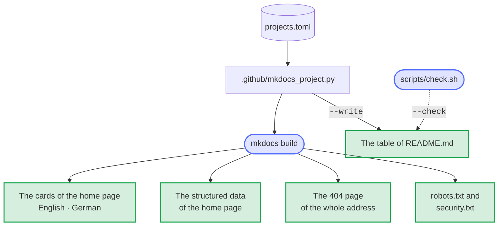
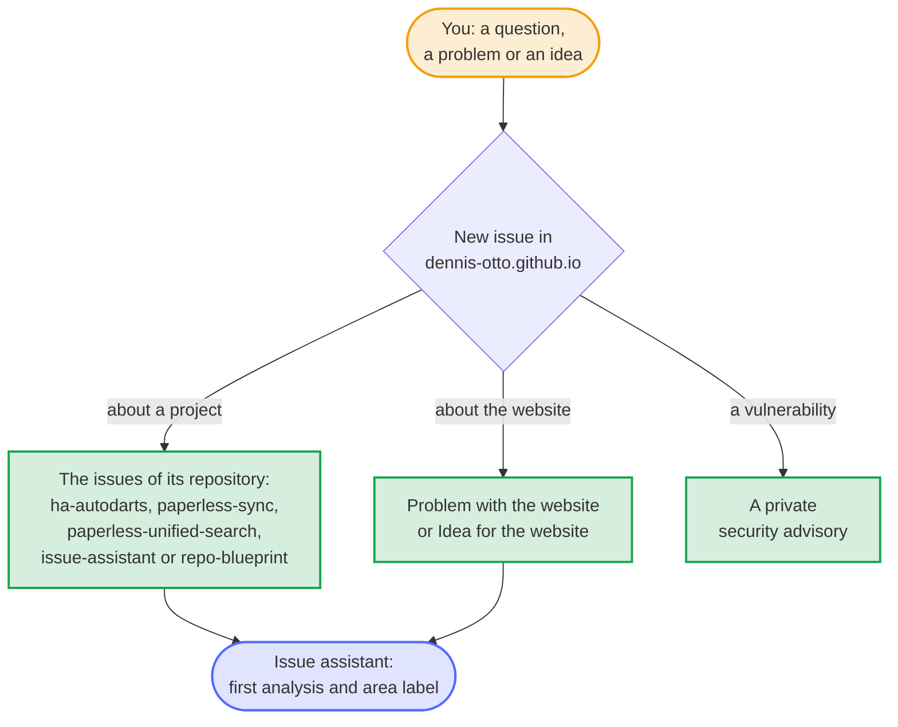

# Dennis Otto

[](https://dennis-otto.github.io/)
[](https://github.com/Dennis-Otto/dennis-otto.github.io/actions/workflows/ci.yml)
[](https://scorecard.dev/viewer/?uri=github.com/Dennis-Otto/dennis-otto.github.io)
[](https://api.reuse.software/info/github.com/Dennis-Otto/dennis-otto.github.io)
[](LICENSE)
[](https://github.com/sponsors/Dennis-Otto)

The website of all projects of Dennis Otto, at [dennis-otto.github.io](https://dennis-otto.github.io/): one page with every project, its install button and its documentation, in English and German.

<sub>💛 If the projects are useful to you, you can [support their development](https://github.com/sponsors/Dennis-Otto).</sub>

## The projects

<!-- projects:start -->

| Project | What it does | Start | Website |
| --- | --- | --- | --- |
| [ha-autodarts](https://github.com/Dennis-Otto/ha-autodarts) | Autodarts for Home Assistant, local and in realtime | [Install with HACS](https://my.home-assistant.io/redirect/hacs_repository/?owner=Dennis-Otto&repository=ha-autodarts&category=integration) | [dennis-otto.github.io/ha-autodarts](https://dennis-otto.github.io/ha-autodarts/) · [dennis-otto.github.io/ha-autodarts/de](https://dennis-otto.github.io/ha-autodarts/de/) |
| [paperless-sync](https://github.com/Dennis-Otto/paperless-sync) | Paperless-ngx documents as an archive in Nextcloud | [Nextcloud App Store](https://apps.nextcloud.com/apps/paperless_sync) | [dennis-otto.github.io/paperless-sync](https://dennis-otto.github.io/paperless-sync/) |
| [paperless-unified-search](https://github.com/Dennis-Otto/paperless-unified-search) | The search of Paperless-ngx in the search of Nextcloud | [Nextcloud App Store](https://apps.nextcloud.com/apps/paperless_unified_search) | [dennis-otto.github.io/paperless-unified-search](https://dennis-otto.github.io/paperless-unified-search/) |
| [issue-assistant](https://github.com/Dennis-Otto/issue-assistant) | A GitHub Action that looks after issues | [Use the action](https://github.com/Dennis-Otto/issue-assistant#set-up-a-repository) | [dennis-otto.github.io/issue-assistant](https://dennis-otto.github.io/issue-assistant/) |
| [repo-blueprint](https://github.com/Dennis-Otto/repo-blueprint) | The template all of these repositories are made from | [Start a repository](https://github.com/Dennis-Otto/repo-blueprint#start-a-repository) · [Repository anlegen](https://github.com/Dennis-Otto/repo-blueprint/blob/main/README.de.md#ein-repository-anlegen) | [dennis-otto.github.io/repo-blueprint](https://dennis-otto.github.io/repo-blueprint/) · [dennis-otto.github.io/repo-blueprint/de](https://dennis-otto.github.io/repo-blueprint/de/) |
| Repository dashboard | The state of every repository at a glance | [Open the dashboard](https://dennis-otto.github.io/repo-blueprint/dashboard/) | — |

<!-- projects:end -->

[dennis-otto.github.io/dashboard](https://dennis-otto.github.io/dashboard/) is the short address of the [dashboard of every repository](https://dennis-otto.github.io/repo-blueprint/dashboard/), which the blueprint builds.

## How the website works

The pages are in [docs/](docs/): `index.md` in English, `index.de.md` in German, and `dashboard/index.html`, which forwards to the dashboard. MkDocs with the Material theme builds them, and the Docs workflow publishes the website on GitHub Pages with every change of `main`. Preview it while you write with

```sh
pip install --require-hashes -r .github/docs-requirements.txt && mkdocs serve
```

The repository comes from the [blueprint](https://github.com/Dennis-Otto/repo-blueprint), whose bot keeps it current.

### One list of the projects

Every project is written once, in [projects.toml](projects.toml): its name, its texts and its links, in English and German. While MkDocs builds the website, the hooks in [.github/mkdocs_project.py](.github/mkdocs_project.py) put a card for each project in place of the line `<!-- projects -->` of both home pages, in the language of the page. The same file writes the table of the projects above, between its two markers:

```sh
python3 -I .github/mkdocs_project.py --write
```

A new project is a new `[[project]]` in projects.toml and this command; the comments at the top of the file describe every key. The same list makes the 404 page, the sitemaps of robots.txt and the structured data of the home page, which [the root of the address](#the-root-of-the-address) describes, so a new project appears there without another edit. The table holds every address of projects.toml, the German ones too, so that the link check, which reads the Markdown files, checks the buttons of the cards as well. `bash scripts/check.sh` fails when the table differs from projects.toml or a project lacks a German text, and the strict build of the website fails when a page or a title of the menu has no German translation.



### The root of the address

The websites of the projects live in folders of the same address, such as `dennis-otto.github.io/ha-autodarts/`, and each is built by the repository of its project. Crawlers, browsers and security researchers look for some files at the root of an address alone, and only this repository can serve them there. So while MkDocs builds the website, the hooks in [.github/mkdocs_project.py](.github/mkdocs_project.py) write them for all six websites:

| At the root | What it does |
| --- | --- |
| `/robots.txt` | Lets every crawler in and names the sitemap of every website of the address: this one, and that of each project of projects.toml whose documentation is at `dennis-otto.github.io`. |
| `/.well-known/security.txt` and `/security.txt` | Tell security researchers how to report a vulnerability of any of the websites privately, as [RFC 9116](https://www.rfc-editor.org/rfc/rfc9116) describes, and link the [security page](https://dennis-otto.github.io/security.html). The file expires a year after the build, and every change of `main` builds it anew. GitHub Pages publishes the copy under `/.well-known/` once the Docs workflow of the blueprint uploads folders whose names start with a dot. |
| The 404 page | Answers every address that leads nowhere outside the websites of the projects, which have 404 pages of their own: in English and German, with every project, the home page and, for a mistyped project such as `/autodarts/`, *Did you mean Autodarts for Home Assistant?* Its template is [overrides/404.html](overrides/404.html). |
| The structured data of the home page | Search engines take the name of a website from the home page at the root of an address alone, for every page below it. The English home page names the website, its owner and every project with its repository, license and platform, as JSON-LD. Its canonical address, the links between its languages and the sitemaps give the root of the address, `https://dennis-otto.github.io/`, as the website does, rather than `index.html` in it. |

## Development

Every change goes through a pull request whose title follows [Conventional Commits](https://www.conventionalcommits.org/), with signed-off commits (`git commit -s`). The checks of the CI run locally with

```sh
bash scripts/check.sh
```

[CONTRIBUTING.md](CONTRIBUTING.md) explains the set-up and the rules.

## Support and security

A question, a problem or an idea about a project belongs to the issues of its own repository, which the table above links. The [issue chooser](https://github.com/Dennis-Otto/dennis-otto.github.io/issues/new/choose) of this repository links each project's issues too; its own two forms are for the website itself, a problem with a page or an idea for it. The documentation of a project, under `dennis-otto.github.io/<project>/`, is built by the project's repository, and its issues take reports about it. [SUPPORT.md](SUPPORT.md) says what happens with an issue. Report vulnerabilities privately, as [SECURITY.md](SECURITY.md) describes.



## License

MIT; see [LICENSE](LICENSE). Every file names its license in the machine-readable form of [REUSE](https://reuse.software).
